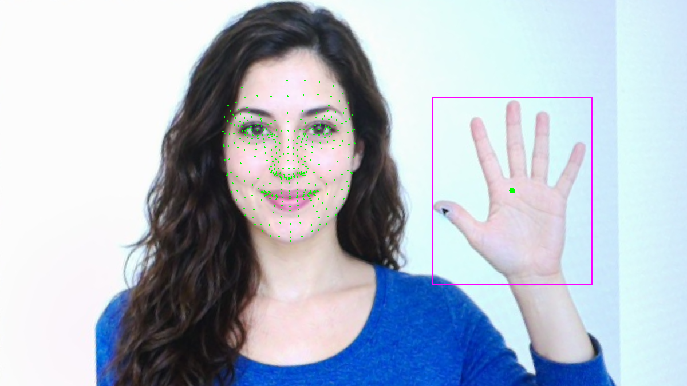
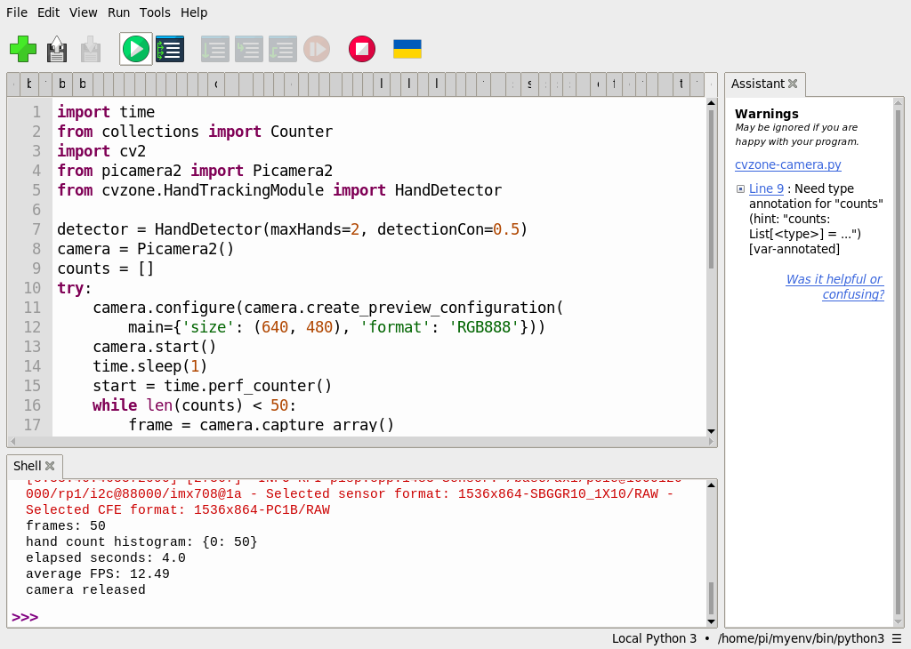

# 50｜手勢偵測：手部 21 個特徵點

## [原課號：補充 2｜🍓 在 Raspberry Pi 5 上用 PiCamera2 + MediaPipe 做手勢偵測](https://github.com/Samuel-ncu/BA5077-RP5-compatibility/blob/main/%E6%95%99%E6%9D%90/%E8%A3%9C%E5%85%85%202%EF%BD%9C%F0%9F%8D%93%20%E5%9C%A8%20Raspberry%20Pi%205%20%E4%B8%8A%E7%94%A8%20PiCamera2%20%2B%20MediaPipe%20%E5%81%9A%E6%89%8B%E5%8B%A2%E5%81%B5%E6%B8%AC.md)

digithouse.net 原文：[補充 2｜在 Raspberry Pi 5 上用 PiCamera2 + MediaPipe 做手勢偵測](https://digithouse.net/blog/supplement-02-picamera2-mediapipe-gesture-detection?locale=zh-TW)

> **本篇狀態**：**目前 Trixie**（2026-11-12，MediaPipe 1.2.2、CVZone 2.0.0）：單張 AI 生成人物圖找到 1 隻手 21 點，判斷為 paper；相機對著沒有手的畫面連續 50 張，全部 0 隻手（19.06 FPS）。這兩項都是用新 49 的環境執行，Thonny 截圖待補。**舊環境**（Bookworm）有 Thonny 的相機無手測試截圖（12.49 FPS）。**尚未實測**：真人的手在相機前的即時偵測（需要參與者）、不同角度與光線、全新安裝的系統。

上一篇我們在一張圖上找到了手，還用「指尖比關節高」判斷出 paper。這篇把相機接上，讓程式一張接一張找手；同時把 21 個特徵點的位置弄清楚，因為之後的距離計算（新 52）和剪刀石頭布（新 53）都建立在這些點上。也要先說明：本次相機前**沒有真人的手**，只測了「沒有手時不會亂找」，真人的部分要你自己來試。

## 這篇會學到什麼

- 手部 21 個特徵點的編號規則。
- 特徵點和手勢名稱的差別：點是模型給的，手勢是程式規則判斷的。
- 用 CVZone 從相機連續找手，並統計每張找到幾隻手。
- 為什麼要做「沒有手」的負例測試。

## 需要的東西

- [新 49](./49-MediaPipe%20%E6%98%AF%E4%BB%80%E9%BA%BC%EF%BC%9F%E5%BB%BA%E7%AB%8B%E7%92%B0%E5%A2%83%E8%88%87%E7%AC%AC%E4%B8%80%E5%80%8B%E7%AF%84%E4%BE%8B.md) 建立的 MediaPipe 環境（讀得到 Picamera2），以及同一個練習資料夾裡的模型檔。
- RP5、CSI 相機和桌面環境。
- [相機手部程式](https://github.com/Samuel-ncu/BA5077-RP5-compatibility/blob/main/%E6%95%99%E6%9D%90/%E7%AF%84%E4%BE%8B%E7%A8%8B%E5%BC%8F/%E8%A3%9C%E5%85%852%E5%92%8C6-Thonny%E7%9B%B8%E6%A9%9F%E6%89%8B%E9%83%A8.py)

## 先懂幾個名詞

- **手部特徵點**：MediaPipe 在每隻手上標出 21 個點，編號 0～20。
- **正例、負例**：正例是「有手」的畫面，用來看找不找得到；負例是「沒有手」的畫面，用來看會不會亂找。兩種都要測。
- **直方圖（histogram）**：這裡指「找到 0 隻手的有幾張、1 隻的有幾張……」的統計。

## 一步一步操作

### 步驟 1：認識 21 個特徵點

**為什麼**：之後所有手勢規則，都是在比較這些點的位置。

| 編號 | 位置 |
| --- | --- |
| 0 | 手腕 |
| 1～4 | 大拇指（由根部到指尖，4 是指尖） |
| 5～8 | 食指（8 是指尖，6 是第二關節） |
| 9～12 | 中指（12 是指尖，10 是第二關節） |
| 13～16 | 無名指（16 是指尖，14 是第二關節） |
| 17～20 | 小指（20 是指尖，18 是第二關節） |

新 49 的手勢規則就是比較 8 和 6、12 和 10、16 和 14、20 和 18：指尖的 y 比第二關節小，代表手指朝上伸直。模型只給出點的位置，「這是 paper」是程式規則自己判斷的。

### 步驟 2：先在圖片上確認

**為什麼**：相機畫面每張都不同，先用固定的圖片確認環境和模型正常。

用新 49 的共用程式和 `facehand-board.png` 執行，確認輸出有 `hands: 1 hand points: [21]` 和 `gesture: paper`。repo 在目前 Trixie 的這項結果就是新 49 的那一次。

### 步驟 3：讀相機手部程式

**為什麼**：把找手的步驟放進相機迴圈，並統計結果。

```python
import time
from collections import Counter
import cv2
from picamera2 import Picamera2
from cvzone.HandTrackingModule import HandDetector

detector = HandDetector(maxHands=2, detectionCon=0.5)
camera = Picamera2()
counts = []
try:
    camera.configure(camera.create_preview_configuration(
        main={'size': (640, 480), 'format': 'RGB888'}))
    camera.start()
    time.sleep(1)
    start = time.perf_counter()
    while len(counts) < 50:
        frame = camera.capture_array()
        hands, shown = detector.findHands(frame, draw=True, flipType=False)
        counts.append(len(hands))
        cv2.imshow('CVZone camera - Q to stop', shown)
        if cv2.waitKey(1) & 0xFF == ord('q'):
            break
    elapsed = time.perf_counter() - start
    print('frames:', len(counts))
    print('hand count histogram:', dict(sorted(Counter(counts).items())))
    print('elapsed seconds:', round(elapsed, 2))
    print('average FPS:', round(len(counts) / elapsed, 2))
finally:
    camera.stop()
    camera.close()
    cv2.destroyAllWindows()
    detector.detector.close()  # CVZone 2.0：關閉 MediaPipe 模型，避免結束時的錯誤訊息
    print('camera released')
```

- `HandDetector(maxHands=2, detectionCon=0.5)`：最多找 2 隻手，信心至少 0.5 才算。這次**沒有**設 `staticMode=True`，連續畫面可以沿用上一張的結果，速度比較快。
- 每張都把找到的手數記進 `counts`，最後用 `Counter` 統計。
- 最多 50 張；先點預覽視窗再按 `q` 可以提前結束。
- `finally`：釋放相機、關視窗，並關閉 MediaPipe 模型。`detector.detector.close()` 是 CVZone 2.0 的寫法，在舊版 CVZone 1.x 會出錯。

### 步驟 4：負例：相機前沒有手

**為什麼**：先確認「沒有手的時候不會亂找」。

本次相機對著螢幕上的 AI 生成物件圖（蘋果、香蕉、杯子），畫面裡沒有手。目前 Trixie 的結果：

```text
frames: 50
hand count histogram: {0: 50}
average FPS: 19.06
camera released
```

50 張全部是 0 隻手，沒有把水果或杯子誤認成手。舊環境的 Thonny 測試也是 50 張全為 0，速度 12.49 張／秒。

### 步驟 5：換你來做正例

**為什麼**：本次沒有真人參與，「找得到手」這一半還沒測。

在自己的 RP5 上，把手放到鏡頭前，執行步驟 3 的程式，試試：

1. 一隻手、手掌張開朝向鏡頭，看 histogram 裡 1 的次數。
2. 兩隻手同時入鏡。
3. 手慢慢側轉、握拳、移出畫面，觀察哪些情況會找不到。

拍攝真人的手之前要先取得當事人同意，也不要把有臉或個人資訊的畫面上傳到公開的地方。

### 步驟 6：和原文比一比

**為什麼**：原文寫在舊系統上，有幾步在目前系統不適用。

- 原文用 `pip install mediapipe==0.10.9` 安裝並使用 `mp.solutions.hands`；目前 Python 3.13 沒有 0.10.x 可裝，1.x 又移除了 `mp.solutions`（見新 49），本篇改用 CVZone 2.0。
- 原文第一步用 `raspi-config` 啟用相機；本系列在新 13 已經用 `rpicam` 確認過相機，本次沒有照原文的這一步操作。
- 原文設定 `RGB888` 後，用 `COLOR_RGB2BGR` 轉換顯示用的畫面，卻把原始影格直接交給 MediaPipe。Picamera2 的 `RGB888` 在記憶體裡其實是 BGR 順序，換相機或格式時要確認色彩順序。
- 原文按 Esc 離開，結束時沒有 `close()` 相機，也沒有關閉模型。

原文的程式本次沒有原樣重跑。

## 成果圖



*程式輸出（目前 Trixie，2026-11-12）：步驟 2 的圖片結果，洋紅框是手的範圍。人物是 AI 生成的虛構人物。*



*操作截圖（舊環境）：步驟 4 的相機無手測試，50 張全為 0 隻手。截圖不含相機畫面。*


*程式輸出（舊環境，MediaPipe 0.10.9）：用舊版 `mp.solutions` 畫出的手部 21 點連線，可以對照步驟 1 的編號表。*

## 常見問題

| 你看到的情況 | 可能原因 | 先試試看 |
| --- | --- | --- |
| `No module named 'picamera2'` | 環境沒有讀到系統套件 | 用新 49 的環境建立程式重建（有 `--system-site-packages`）。 |
| `'HandDetector' object has no attribute 'detector'` | 裝到舊版 CVZone 1.x | 確認是 `cvzone==2.0.0`。 |
| 一直找不到手 | 手太小、太暗或側面 | 靠近鏡頭、手掌朝前、光線充足。 |
| 相機打不開 | 另一支程式還在用相機 | 等上一支印出 `camera released`。 |

以上是常見情況的整理，本次沒有逐一重現。

## 小結

MediaPipe 在每隻手上標出 21 個特徵點，手勢則是程式比較這些點的位置判斷出來的。本次在目前 Trixie 上，圖片中的手找到 21 點並判斷為 paper；相機對著沒有手的畫面 50 張，全部 0 隻手，沒有誤判。真人在相機前的正例還沒有測，需要你自己試，也要注意拍攝真人的同意與隱私。

**練習**：用步驟 1 的編號表，寫出判斷「大拇指朝上」的規則（提示：比較 4 號和哪一點的 y？手要怎麼擺？）。這是思考練習，本次尚未實測。

## 下一篇預告

找得到手，也能找臉。下一篇[51｜臉部網格：新版回傳 478 點](./51-%E8%87%89%E9%83%A8%E7%B6%B2%E6%A0%BC%EF%BC%9A%E6%96%B0%E7%89%88%E5%9B%9E%E5%82%B3%20478%20%E9%BB%9E.md)，我們看 MediaPipe 在臉上標出的 478 個點，以及為什麼新版比舊版多了 10 點。
