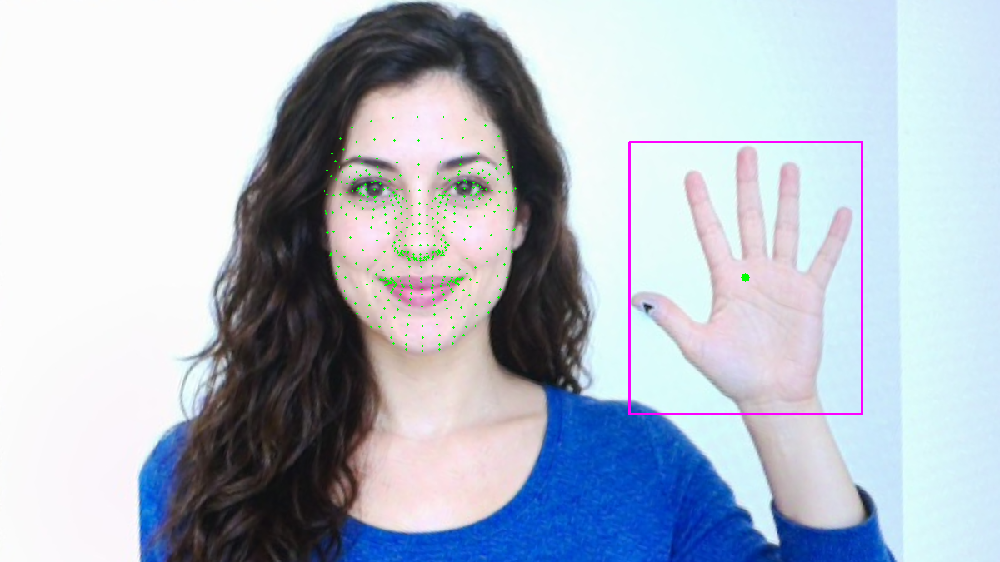
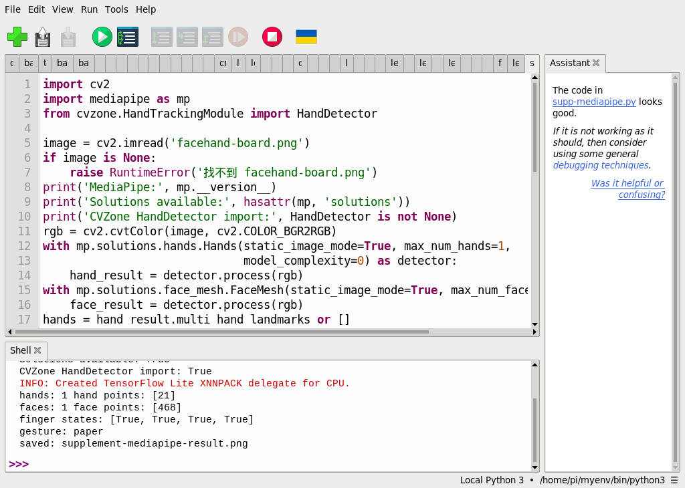

# 51｜臉部網格：新版回傳 478 點

## [原課號：補充 4｜📸 Raspberry Pi 5 + PiCamera2 + MediaPipe Face Mesh 教學（支援 468 點臉部特徵點）](https://github.com/Samuel-ncu/BA5077-RP5-compatibility/blob/main/%E6%95%99%E6%9D%90/%E8%A3%9C%E5%85%85%204%EF%BD%9C%F0%9F%93%B8%20Raspberry%20Pi%205%20%2B%20PiCamera2%20%2B%20MediaPipe%20Face%20Mesh%20%E6%95%99%E5%AD%B8%EF%BC%88%E6%94%AF%E6%8F%B4%20468%20%E9%BB%9E%E8%87%89%E9%83%A8%E7%89%B9%E5%BE%B5%E9%BB%9E%EF%BC%89.md)

digithouse.net 原文：[補充 4｜Raspberry Pi 5 + PiCamera2 + MediaPipe Face Mesh 教學（支援 468 點臉部特徵點）](https://digithouse.net/blog/supplement-04-picamera2-mediapipe-face-mesh?locale=zh-TW)

> **本篇狀態**：**目前 Trixie**（2026-11-12，MediaPipe 1.2.2、CVZone 2.0.0）：對一張 AI 生成虛構人物圖找到 1 張臉、**478 點**。這是新 49 的同一次執行，用同一個環境從 SSH 啟動。**舊環境**（Bookworm，MediaPipe 0.10.9）用 Thonny 實測同一張圖，得到 468 點並畫出臉部輪廓。**尚未實測**：相機即時臉部網格、真人（需要參與者與同意）、不同角度與光線、全新安裝的系統。

上一篇看了手上的 21 個點，這篇換到臉上。MediaPipe 能在一張臉上標出幾百個點，連起來像一張網，所以叫「臉部網格」。原文的標題寫 468 點，但你在目前的系統上會數到 **478 點**。這篇就從這 10 點的差別開始，看懂臉部特徵點是什麼、能拿來做什麼，以及使用臉部資料時要注意的事。

## 這篇會學到什麼

- 臉部網格是什麼，和臉部偵測、臉部辨識有什麼不同。
- 為什麼新版是 478 點：多出來的 10 點是虹膜。
- 不要把點數寫死在程式裡。
- 臉部資料的隱私與同意。

## 需要的東西

- [新 49](./49-MediaPipe%20%E6%98%AF%E4%BB%80%E9%BA%BC%EF%BC%9F%E5%BB%BA%E7%AB%8B%E7%92%B0%E5%A2%83%E8%88%87%E7%AC%AC%E4%B8%80%E5%80%8B%E7%AF%84%E4%BE%8B.md) 建立的 MediaPipe 環境和 CVZone 共用程式。
- 同一個練習資料夾裡的 [facehand-board.png](https://github.com/Samuel-ncu/BA5077-RP5-compatibility/blob/main/%E6%95%99%E6%9D%90/%E5%9C%96%E6%AA%94/facehand-board.png)（AI 生成虛構人物，不是真人）。

## 先懂幾個名詞

- **臉部網格（Face Mesh）**：在臉上標出幾百個固定位置的點，例如眼角、鼻尖、嘴角、臉的輪廓。
- **虹膜（iris）**：眼睛中有顏色的那一圈。新版模型在左右眼各多標 5 點。
- **特徵點 vs. 身分**：特徵點只說明「臉的各個位置在哪裡」，**不會**告訴你這是誰。認人是[新 36](./36-%E8%AA%8D%E5%87%BA%E6%98%AF%E8%AA%B0%E7%9A%84%E8%87%89%EF%BC%9ALBPH%20%E8%87%89%E9%83%A8%E8%BE%A8%E8%AD%98.md) 的臉部辨識，是另一件事。

## 一步一步操作

### 步驟 1：再看一次新 49 的輸出

**為什麼**：臉部的結果已經在那一次執行裡。

用新 49 的環境執行 CVZone 共用程式，Shell 裡關於臉的那一行：

```text
faces: 1 face points: [478]
```

共用程式裡找臉的部分只有兩行：

```python
face_detector = FaceMeshDetector(staticMode=True, maxFaces=1)
image, faces = face_detector.findFaceMesh(image, draw=True)
```

`faces` 是一個串列，每張臉是一串點的座標；`len(f)` 就是點數。`draw=True` 會把點畫在圖上，結果圖裡臉上的綠點就是這些特徵點。

### 步驟 2：468 和 478 差在哪

**為什麼**：照抄舊程式時，最容易在這裡出錯。

| | 舊版 Face Mesh | 新版 Face Landmarker |
| --- | --- | --- |
| 使用方式 | `mp.solutions.face_mesh`（MediaPipe 0.10.9） | MediaPipe 1.x 的 Tasks API（CVZone 2.0 使用） |
| 點數 | 468 | 478 |
| 多出來的點 | — | 左右眼虹膜各 5 點 |

新版的前 468 點仍是原本的臉部網格，最後 10 點（編號 468～477）是虹膜。所以如果你的程式寫死 `range(468)` 或用 `== 468` 判斷，在新版會算錯；請一律用 `len(face)`。

舊環境（MediaPipe 0.10.9）同一張圖的輸出是 `faces: 1 face points: [468]`。

### 步驟 3：特徵點能做什麼

**為什麼**：知道點的用途，才知道要量哪些點。

幾個常見的用法，都是在比較點和點之間的距離或角度：

- **眨眼偵測**：比較眼睛上緣和下緣的點距離，變小就是閉眼。
- **嘴巴開合**：比較上唇和下唇的點距離。
- **頭部方向**：比較鼻尖和左右臉頰的位置。
- **AR 貼圖**：把虛擬眼鏡、帽子貼在對應的點上。

這些都只是應用方向的整理，本次**沒有實測**。要做成能用的功能，還需要在不同的人、角度、光線下測試誤判。

### 步驟 4：臉部資料要小心

**為什麼**：臉是很敏感的個人資料。

- 用真人測試前，先取得當事人同意。
- 不要把拍到臉的照片或影片上傳到公開的地方。
- 特徵點座標也可能被拿來辨認一個人，存檔前想清楚用途和保存期限。

本次所有實測都用 AI 生成的虛構人物，就是為了避開真人的隱私問題。

### 步驟 5：和原文比一比

**為什麼**：原文的點數和程式設定其實互相矛盾。

- 原文用 `pip install mediapipe==0.10.9` 和 `mp.solutions.face_mesh`；目前 Python 3.13 只能裝 MediaPipe 1.x，`mp.solutions` 已移除（見新 49）。
- 原文程式設了 `refine_landmarks=True`（註解寫「支援眼睛／唇細節」）。在舊版 API，這個選項就會加上虹膜的點，回傳 478 點；但原文的標題和說明都寫 468 點。
- 原文設定 `RGB888` 後，先用 `COLOR_RGB2BGR` 轉換，再把轉換後的影像交給 Face Mesh；Picamera2 的 `RGB888` 在記憶體裡其實是 BGR 順序，換相機或格式時要確認色彩順序。
- 原文用 Picamera2 即時畫出整張網格（`FACEMESH_TESSELATION`），按 Esc 結束，結束時沒有 `close()` 相機。

原文的相機即時版本本次沒有測試。

## 成果圖



*程式輸出（目前 Trixie，2026-11-12）：臉上的綠點是 478 個特徵點。人物是 AI 生成的虛構人物。*


*程式輸出（舊環境，MediaPipe 0.10.9）：舊版只畫出臉部輪廓、眉毛、眼睛、嘴唇的連線。*



*操作截圖（舊環境）：Thonny 的輸出，臉部是 468 點。*

## 常見問題

| 你看到的情況 | 可能原因 | 先試試看 |
| --- | --- | --- |
| 點數是 478，不是教材寫的 468 | 新版模型多了虹膜 10 點 | 這是正常的；程式改用 `len(face)`。 |
| `faces: 0` | 臉太小、太側面或太暗 | 換一張正面、清楚的臉。 |
| `module 'mediapipe' has no attribute 'solutions'` | 用了舊程式 | 改用新 49 的 CVZone 共用程式。 |
| 結束時出現 `Exception ignored ... __del__` | 沒有關閉模型 | 確認程式最後有關閉模型的兩行。 |

以上是常見情況的整理，本次沒有逐一重現。

## 小結

臉部網格在臉上標出固定位置的點，說明「臉的各部位在哪裡」，不說明「這是誰」。新版 MediaPipe 回傳 478 點：前 468 點是原本的網格，後 10 點是虹膜，所以程式不要寫死點數。本次在目前 Trixie 上，AI 生成虛構人物圖找到 478 點；相機即時與真人都還沒測，用真人前要先取得同意。

**練習**：想一想，如果要做「眨眼偵測」，你會怎麼決定「閉眼」的門檻？要準備哪些測試資料，才能知道門檻設得好不好？這是思考練習，本次尚未實測。

## 下一篇預告

回到手部。下一篇[52｜兩隻手有多遠：CVZone 距離計算](./52-%E5%85%A9%E9%9A%BB%E6%89%8B%E6%9C%89%E5%A4%9A%E9%81%A0%EF%BC%9ACVZone%20%E8%B7%9D%E9%9B%A2%E8%A8%88%E7%AE%97.md)，我們同時找兩隻手，量兩根食指指尖相距幾個像素，並了解像素距離為什麼不能直接當成公分。
