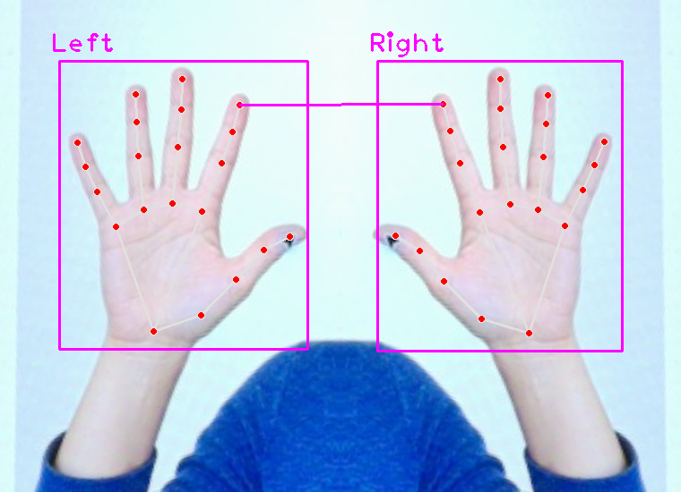
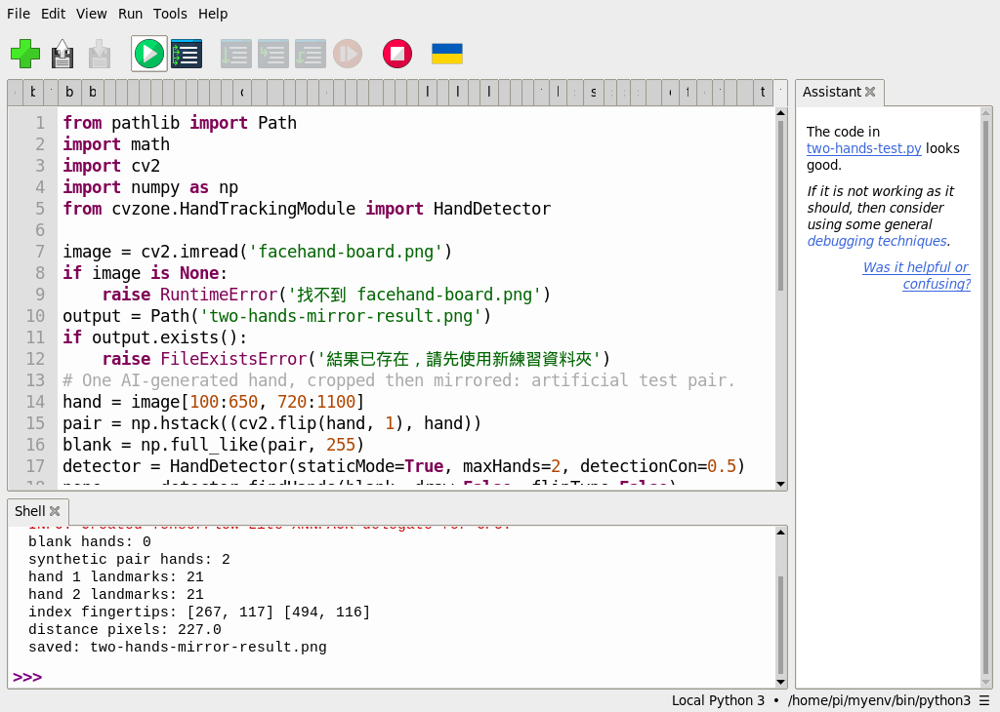

# 52｜兩隻手有多遠：CVZone 距離計算

## [原課號：補充 6｜🧠 RP5 + CVZone + MediaPipe + PiCamera2 雙手偵測與距離計算教學](https://github.com/Samuel-ncu/BA5077-RP5-compatibility/blob/main/%E6%95%99%E6%9D%90/%E8%A3%9C%E5%85%85%206%EF%BD%9C%F0%9F%A7%A0%20RP5%20%2B%20CVZone%20%2B%20MediaPipe%20%2B%20PiCamera2%20%E9%9B%99%E6%89%8B%E5%81%B5%E6%B8%AC%E8%88%87%E8%B7%9D%E9%9B%A2%E8%A8%88%E7%AE%97%E6%95%99%E5%AD%B8.md)

digithouse.net 原文：[補充 6｜RP5 + CVZone + MediaPipe + PiCamera2 雙手偵測與距離計算教學](https://digithouse.net/blog/supplement-06-cvzone-two-hand-distance?locale=zh-TW)

> **本篇狀態**：**目前 Trixie**（2026-11-12，MediaPipe 1.2.2、CVZone 2.0.0）：把同一隻 AI 生成的手裁切、鏡像，拼成「兩隻手」的測試圖，找到 2 隻手各 21 點，兩根食指尖相距 228.0 像素；全白圖 0 隻手。這次是用新 49 的環境從 SSH 啟動。**舊環境**（Bookworm）用 Thonny 跑同一支程式，距離 227.0 像素。**尚未實測**：兩隻真人的手在相機前的即時距離（需要參與者）、像素換算成公分。

前兩篇都只找一隻手。這篇同時找**兩隻手**，再用國中學過的畢氏定理，算出兩根食指指尖相距多遠。答案的單位是**像素**，不是公分，這點很重要。因為本次沒有真人參與，我們用一個小技巧做出兩隻手：把 AI 生成圖上的那隻手裁下來，左右翻轉後並排。

## 這篇會學到什麼

- 影像座標系：原點在左上角，x 向右、y 向下。
- 從兩隻手的特徵點取出食指指尖，用 `math.dist` 算距離。
- 為什麼要先用全白圖測「沒有手」。
- 像素距離為什麼不能直接當成公分。

## 需要的東西

- [新 49](./49-MediaPipe%20%E6%98%AF%E4%BB%80%E9%BA%BC%EF%BC%9F%E5%BB%BA%E7%AB%8B%E7%92%B0%E5%A2%83%E8%88%87%E7%AC%AC%E4%B8%80%E5%80%8B%E7%AF%84%E4%BE%8B.md) 的 MediaPipe 環境。
- 一個**新的**練習資料夾，放：
  - [facehand-board.png](https://github.com/Samuel-ncu/BA5077-RP5-compatibility/blob/main/%E6%95%99%E6%9D%90/%E5%9C%96%E6%AA%94/facehand-board.png)（AI 生成虛構人物，不是真人）
  - [雙手測試程式](https://github.com/Samuel-ncu/BA5077-RP5-compatibility/blob/main/%E6%95%99%E6%9D%90/%E7%AF%84%E4%BE%8B%E7%A8%8B%E5%BC%8F/%E8%A3%9C%E5%85%856-Thonny%E9%9B%99%E6%89%8B%E7%B4%A0%E6%9D%90%E6%B8%AC%E8%A9%A6.py)

## 先懂幾個名詞

- **影像座標**：用 `(x, y)` 表示一個像素的位置，左上角是 `(0, 0)`。
- **歐幾里得距離**：兩點的直線距離，`√((x2−x1)² + (y2−y1)²)`，Python 的 `math.dist` 會幫你算。
- **鏡像**：左右翻轉，`cv2.flip(image, 1)`。

## 一步一步操作

### 步驟 1：讀程式

**為什麼**：重點是「做出兩隻手」和「取出指尖算距離」。

```python
from pathlib import Path
import math
import cv2
import numpy as np
from cvzone.HandTrackingModule import HandDetector

image = cv2.imread('facehand-board.png')
if image is None:
    raise RuntimeError('找不到 facehand-board.png')
output = Path('two-hands-mirror-result.png')
if output.exists():
    raise FileExistsError('結果已存在，請先使用新練習資料夾')
# One AI-generated hand, cropped then mirrored: artificial test pair.
hand = image[100:650, 720:1100]
pair = np.hstack((cv2.flip(hand, 1), hand))
blank = np.full_like(pair, 255)
detector = HandDetector(staticMode=True, maxHands=2, detectionCon=0.5)
none, _ = detector.findHands(blank, draw=False, flipType=False)
print('blank hands:', len(none))
hands, annotated = detector.findHands(pair.copy(), draw=True, flipType=False)
print('synthetic pair hands:', len(hands))
for index, item in enumerate(hands):
    print('hand', index + 1, 'landmarks:', len(item['lmList']))
if len(hands) == 2:
    p1 = hands[0]['lmList'][8][:2]
    p2 = hands[1]['lmList'][8][:2]
    distance = math.dist(p1, p2)
    cv2.line(annotated, tuple(p1), tuple(p2), (255, 0, 255), 2)
    print('index fingertips:', p1, p2)
    print('distance pixels:', round(distance, 2))
    if not cv2.imwrite(str(output), annotated):
        raise RuntimeError('無法儲存結果圖片')
    print('saved:', output)
else:
    print('distance unavailable: need exactly two hands')
detector.detector.close()  # CVZone 2.0：關閉 MediaPipe 模型，避免結束時的錯誤訊息
```

- `image[100:650, 720:1100]`：裁出圖片右邊那隻手（先寫列範圍，再寫行範圍）。
- `np.hstack((cv2.flip(hand, 1), hand))`：把翻轉後的手和原本的手左右並排，變成「兩隻手」。
- `blank`：同樣大小的全白圖，當作「沒有手」的負例。
- `maxHands=2`：最多找兩隻手。
- `lmList[8][:2]`：第 8 點是食指指尖（見[新 50](./50-%E6%89%8B%E5%8B%A2%E5%81%B5%E6%B8%AC%EF%BC%9A%E6%89%8B%E9%83%A8%2021%20%E5%80%8B%E7%89%B9%E5%BE%B5%E9%BB%9E.md) 的編號表），取前兩個數字 `(x, y)`。
- `math.dist(p1, p2)`：兩個指尖的直線距離；`cv2.line` 把它畫出來。
- 結果圖已存在時程式會停下來，避免覆蓋。

### 步驟 2：執行

**為什麼**：看兩隻手是否都找到、距離多少。

目前 Trixie 的輸出：

```text
blank hands: 0
synthetic pair hands: 2
hand 1 landmarks: 21
hand 2 landmarks: 21
index fingertips: [266, 115] [494, 114]
distance pixels: 228.0
```

- 全白圖 0 隻手：沒有亂找。
- 兩隻手各 21 點。
- 兩個指尖的 y 幾乎一樣（115 和 114），x 差 228，所以距離約 228 像素。

舊環境（MediaPipe 0.10.9）同一支程式得到 `[267, 117] [494, 116]`、227.0 像素。模型版本不同，指尖位置差了一兩個像素，這是正常的。

### 步驟 3：像素不是公分

**為什麼**：這是最容易誤用的地方。

同樣兩隻手，離鏡頭近一點，在畫面上就變大，像素距離也跟著變大；換一台解析度不同的相機，數字也會不同；手斜著拿，距離又會被透視縮短。所以 228 像素**不能**直接換成幾公分。如果真的要量公分，需要放一個已知大小的參考物在同樣的距離，或做相機校正。

這張測試圖是同一隻手鏡像出來的，**不是兩隻真人的手**，也不是即時相機，只用來確認程式算得出距離。

### 步驟 4：和原文比一比

**為什麼**：原文是相機即時版本，算的點也不一樣。

- 原文用 `pip install mediapipe==0.10.9`，並從 GitHub 安裝 CVZone；本篇用新 49 的環境（MediaPipe 1.2.2、`cvzone==2.0.0`）。
- 原文用 Picamera2 即時找雙手，算的是兩個**手掌中心**（`hand["center"]`）的距離，用 `math.hypot`；本篇算**食指指尖**的距離，用 `math.dist`。兩者都是像素。
- 原文另外用 `fingersUp()` 顯示每隻手伸出幾根手指，本篇沒有測試。
- 原文按 Esc 結束，結束時沒有 `close()` 相機。

原文的相機即時版本本次沒有測試。

## 成果圖



*程式輸出（舊環境）：同一隻 AI 生成的手鏡像並排，洋紅線連接兩根食指指尖。*



*操作截圖（舊環境）：Thonny 的輸出，距離 227.0 像素。*

## 常見問題

| 你看到的情況 | 可能原因 | 先試試看 |
| --- | --- | --- |
| `distance unavailable: need exactly two hands` | 只找到一隻手或一隻都沒有 | 確認裁切範圍有包含整隻手；換一張手更清楚的圖。 |
| `結果已存在` | 資料夾裡已有上次的結果圖 | 換一個新的練習資料夾。 |
| `'HandDetector' object has no attribute 'detector'` | 裝到舊版 CVZone 1.x | 確認是 `cvzone==2.0.0`。 |
| 距離每次都差一點 | 模型版本、圖片大小不同 | 這是正常的；比較時固定條件。 |

以上是常見情況的整理，本次沒有逐一重現。

## 小結

兩隻手的距離，就是兩個特徵點的直線距離。本次在目前 Trixie 上，用同一隻 AI 生成的手鏡像出兩隻手，找到各 21 點，兩根食指指尖相距 228.0 像素；全白圖不會找到手。這個距離是像素，會隨遠近、解析度、角度改變，不能直接當成公分；兩隻真人的手在相機前的即時測試也還沒做。

**練習**：

1. 把 `lmList[8]` 改成 `lmList[4]`（大拇指指尖），先預測距離會變大還是變小，再執行驗證。
2. 想一想：如果要讓距離換算成公分，你會在畫面裡放什麼參考物？要怎麼算？

這些是延伸練習，本次尚未實測，請以你實際得到的輸出為準。

## 下一篇預告

會判斷手勢、也會量距離了，來做個小遊戲吧。下一篇[53｜剪刀石頭布：把手勢變成遊戲](./53-%E5%89%AA%E5%88%80%E7%9F%B3%E9%A0%AD%E5%B8%83%EF%BC%9A%E6%8A%8A%E6%89%8B%E5%8B%A2%E8%AE%8A%E6%88%90%E9%81%8A%E6%88%B2.md)，我們把手勢規則整理成剪刀石頭布的判斷，看看目前做到哪裡、還缺什麼。
