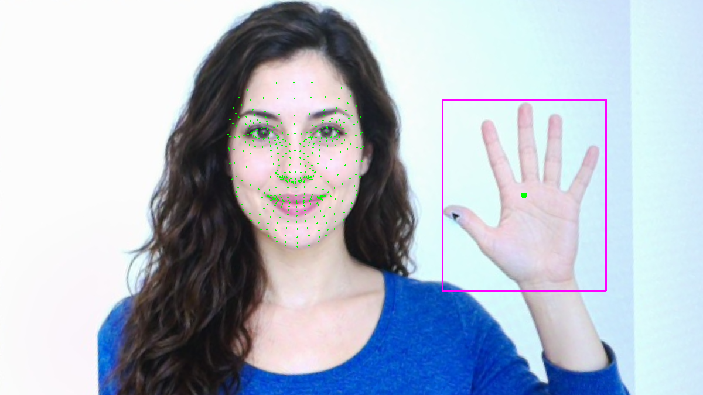
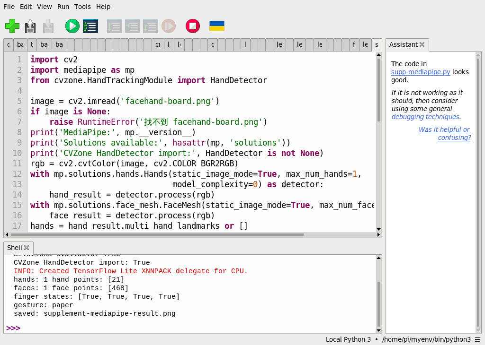

# 53｜剪刀石頭布：把手勢變成遊戲

## [原課號：補充 5｜✊🤚✌️ Raspberry Pi 5 + PiCamera2 + MediaPipe 手勢辨識遊戲：「剪刀、石頭、布」](https://github.com/Samuel-ncu/BA5077-RP5-compatibility/blob/main/%E6%95%99%E6%9D%90/%E8%A3%9C%E5%85%85%205%EF%BD%9C%E2%9C%8A%F0%9F%A4%9A%E2%9C%8C%EF%B8%8F%20Raspberry%20Pi%205%20%2B%20PiCamera2%20%2B%20MediaPipe%20%E6%89%8B%E5%8B%A2%E8%BE%A8%E8%AD%98%E9%81%8A%E6%88%B2%EF%BC%9A%E3%80%8C%E5%89%AA%E5%88%80%E3%80%81%E7%9F%B3%E9%A0%AD%E3%80%81%E5%B8%83%E3%80%8D.md)

digithouse.net 原文：[補充 5｜Raspberry Pi 5 + PiCamera2 + MediaPipe 手勢辨識遊戲：「剪刀、石頭、布」](https://digithouse.net/blog/supplement-05-mediapipe-rock-paper-scissors?locale=zh-TW)

> **本篇狀態**：**只驗證了「布」**。目前 Trixie（2026-11-12，MediaPipe 1.2.2、CVZone 2.0.0）與舊環境（Bookworm，MediaPipe 0.10.9，Thonny）對同一張 AI 生成的張開手掌圖，都判斷為 paper。目前 Trixie 那次是用新 49 的環境從 SSH 啟動。**尚未實測**：剪刀、石頭、相機即時判斷、勝負流程，這些都需要真人在相機前比手勢。

剪刀石頭布是把手勢變成遊戲最直接的例子：先判斷玩家出了什麼，再和電腦比勝負。前面幾篇我們已經有判斷手勢的規則，這篇把它整理清楚，看看規則怎麼區分三種手勢、哪裡容易判錯。也要老實說：本次只有一張張開手掌的圖片，只驗證到「布」，剪刀和石頭要等你用自己的手來試。

## 這篇會學到什麼

- 用四根手指的「伸直／彎曲」組合判斷剪刀、石頭、布。
- 為什麼規則沒有用大拇指。
- 規則容易失效的情況。
- 遊戲還缺哪些部分，以及怎麼測。

## 需要的東西

- [新 49](./49-MediaPipe%20%E6%98%AF%E4%BB%80%E9%BA%BC%EF%BC%9F%E5%BB%BA%E7%AB%8B%E7%92%B0%E5%A2%83%E8%88%87%E7%AC%AC%E4%B8%80%E5%80%8B%E7%AF%84%E4%BE%8B.md) 的 MediaPipe 環境和 CVZone 共用程式。
- 想做相機測試的話，用[新 50](./50-%E6%89%8B%E5%8B%A2%E5%81%B5%E6%B8%AC%EF%BC%9A%E6%89%8B%E9%83%A8%2021%20%E5%80%8B%E7%89%B9%E5%BE%B5%E9%BB%9E.md) 的相機手部程式，以及**願意參與、已同意拍攝**的人。

## 先懂幾個名詞

- **手指狀態**：每根手指是伸直（`True`）還是彎曲（`False`）。
- **規則式判斷**：人寫好 `if ... elif ...` 來分類，不需要訓練。簡單、好懂，但遇到沒想到的情況就會判錯。
- **分類器**：用很多有標註的例子訓練出來的模型，例如原文提到的 KNN、SVM。

## 一步一步操作

### 步驟 1：看懂判斷規則

**為什麼**：遊戲的核心就是這幾行。

新 49 共用程式裡的手勢判斷：

```python
up = [points[tip][1] < points[pip][1] for tip, pip in [(8, 6), (12, 10), (16, 14), (20, 18)]]
if all(up):
    gesture = 'paper'
elif not any(up):
    gesture = 'rock'
elif up == [True, True, False, False]:
    gesture = 'scissors'
else:
    gesture = 'unknown'
```

`up` 依序是食指、中指、無名指、小指是否伸直（指尖的 y 比第二關節小）。

| 手勢 | 食指 | 中指 | 無名指 | 小指 |
| --- | --- | --- | --- | --- |
| 布（paper） | 伸直 | 伸直 | 伸直 | 伸直 |
| 石頭（rock） | 彎曲 | 彎曲 | 彎曲 | 彎曲 |
| 剪刀（scissors） | 伸直 | 伸直 | 彎曲 | 彎曲 |
| 其他 | unknown | | | |

### 步驟 2：本次的結果

**為什麼**：確認「布」判斷得出來。

對 `facehand-board.png` 上張開的手，目前 Trixie 和舊環境都輸出：

```text
finger states: [True, True, True, True]
gesture: paper
```

四根手指都伸直，判斷為布。剪刀和石頭本次**沒有素材可測**。

### 步驟 3：規則什麼時候會失效

**為什麼**：知道限制，才知道要測什麼。

- **手倒過來或橫著**：規則假設手指朝上；手指朝下時，「指尖比關節高」就不成立了。
- **手掌側面對鏡頭**：手指互相遮住，特徵點位置可能不準。
- **半彎的手指**：介於伸直和彎曲之間，結果會在兩者之間跳動。
- **大拇指**：規則沒有用它。大拇指是往旁邊張開，不是往上，用 y 比較不準；而且左手、右手、鏡像畫面的方向都不一樣。

### 步驟 4：遊戲還缺什麼

**為什麼**：判斷出手勢只是第一步。

完整的剪刀石頭布還需要：

1. **倒數**：3、2、1 後才讀玩家的手勢，避免還在換手勢時就被判斷。
2. **穩定判斷**：連續好幾張都是同一個手勢才算數，避免一張判錯就決定勝負。
3. **電腦出拳**：用 `random.choice(['rock', 'paper', 'scissors'])`。
4. **判斷勝負**：石頭贏剪刀、剪刀贏布、布贏石頭，一樣就平手；`unknown` 要請玩家重出。

這些部分本次**都沒有實作或測試**。要測的話，請參與者分別比出三種手勢、各試多次，記錄判斷對了幾次、錯成什麼。拍攝真人前要先取得同意。

### 步驟 5：和原文比一比

**為什麼**：原文的規則多用了大拇指，方向會影響結果。

- 原文用 `pip install mediapipe==0.10.9` 和 `mp.solutions.hands`；目前 Python 3.13 不能用（見新 49）。
- 原文用五根手指判斷，大拇指用「指尖 4 的 x 比關節 3 的 x 大」。這個方向只對某一隻手、某個畫面方向成立；換手或畫面左右翻轉，大拇指就會判反，於是張開的手可能判不成 Paper。本篇的規則不使用大拇指。
- 原文設定 `RGB888` 後，用 `COLOR_RGB2BGR` 轉換再交給 MediaPipe；Picamera2 的 `RGB888` 在記憶體裡其實是 BGR 順序，換相機或格式時要確認色彩順序。
- 原文按 Esc 結束，沒有 `close()` 相機。原文最後建議的「玩家對電腦」「倒數計時」等延伸功能，也沒有提供程式。

原文的相機即時版本本次沒有測試。

## 成果圖



*程式輸出（目前 Trixie，2026-11-12）：張開的手被判斷為 paper。人物是 AI 生成的虛構人物。*



*操作截圖（舊環境）：Thonny 輸出 `finger states` 和 `gesture: paper`。*

## 常見問題

| 你看到的情況 | 可能原因 | 先試試看 |
| --- | --- | --- |
| 明明比剪刀，卻顯示 unknown | 無名指或小指沒有完全彎下 | 把無名指、小指確實彎下，手指朝上。 |
| 結果一直跳動 | 手指半彎，或手在移動 | 手停穩再判斷；連續多張一致才算數。 |
| 手倒過來就判錯 | 規則假設手指朝上 | 這是規則的限制；可以改用和手腕的相對位置判斷。 |
| `hands: 0` | 手太小、太暗或側面 | 靠近鏡頭、手掌朝前、光線充足。 |

以上是常見情況的整理，本次沒有逐一重現。

## 小結

剪刀石頭布的判斷，是比較四根手指的指尖和第二關節：全伸直是布、全彎是石頭、只有食指中指伸直是剪刀。本次只驗證到張開手掌的「布」；剪刀、石頭、相機即時判斷和勝負流程都還沒測，需要真人參與。規則簡單好懂，但手的方向、遮擋、半彎都可能讓它判錯。

**練習**：

1. 根據步驟 4，用自己的話寫出「判斷勝負」的規則，並列出所有 9 種組合的結果。
2. 請同學（先取得同意）分別比出三種手勢各 10 次，用新 50 的相機程式加上本篇的規則，記錄判斷對了幾次。

這些是延伸練習，本次尚未實測，請以你實際得到的輸出為準。

## 下一篇預告

手勢系列到這裡結束。下一篇[54｜找出圖中的文字框：EAST](./54-%E6%89%BE%E5%87%BA%E5%9C%96%E4%B8%AD%E7%9A%84%E6%96%87%E5%AD%97%E6%A1%86%EF%BC%9AEAST.md)，我們換個題目：讓電腦在一張圖裡找出「哪裡有文字」。
