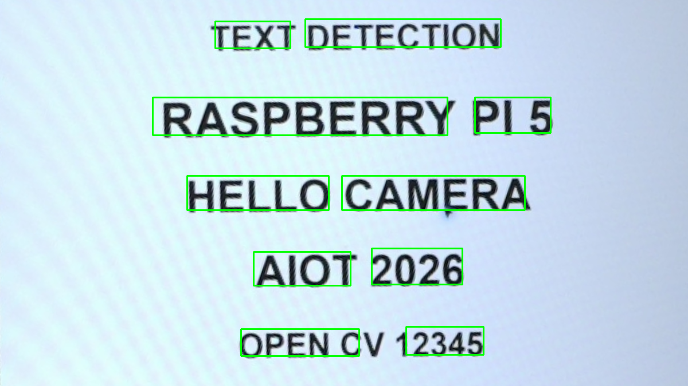
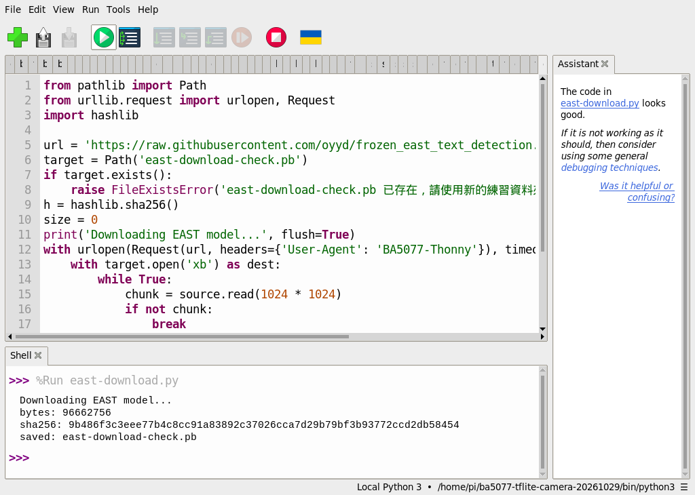
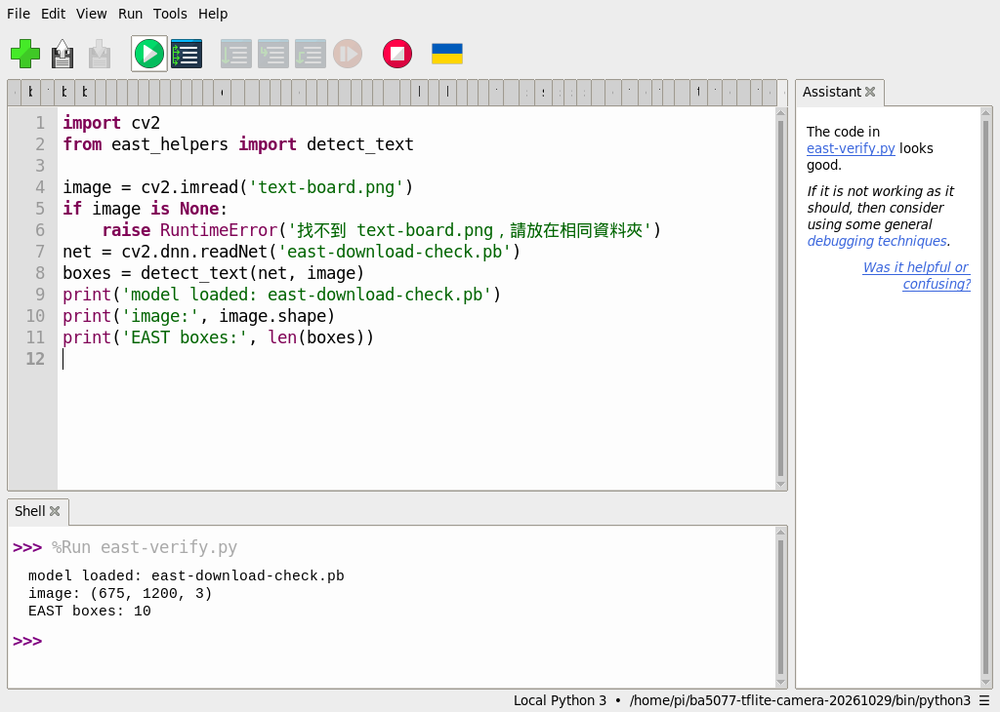
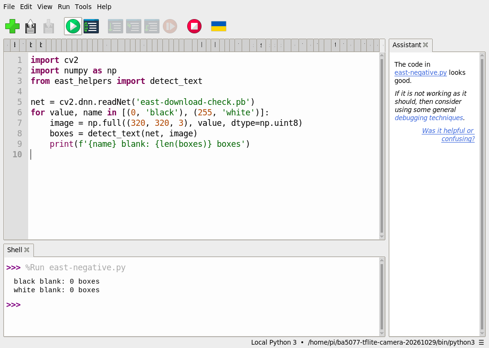

# 54｜找出圖中的文字框：EAST

## [原課號：補充 9｜EAST（Efficient and Accurate Scene Text Detector）文字偵測演算法 的 完整 Python 教學](https://github.com/Samuel-ncu/BA5077-RP5-compatibility/blob/main/%E6%95%99%E6%9D%90/%E8%A3%9C%E5%85%85%209%EF%BD%9CEAST%EF%BC%88Efficient%20and%20Accurate%20Scene%20Text%20Detector%EF%BC%89%E6%96%87%E5%AD%97%E5%81%B5%E6%B8%AC%E6%BC%94%E7%AE%97%E6%B3%95%20%E7%9A%84%20%E5%AE%8C%E6%95%B4%20Python%20%E6%95%99%E5%AD%B8.md)

digithouse.net 原文：[補充 9｜EAST 文字偵測演算法的完整 Python 教學](https://digithouse.net/blog/supplement-09-east-text-detection?locale=zh-TW)

> **本篇狀態**：**目前 Trixie**（2026-11-12，[新 11](./11-%E5%9C%A8%20Thonny%20%E6%BA%96%E5%82%99%20OpenCV%20%E5%B7%A5%E5%85%B7%E7%AE%B1%EF%BC%9A%E8%99%9B%E6%93%AC%E7%92%B0%E5%A2%83%E8%88%87%E5%AE%89%E8%A3%9D.md) 的 OpenCV 環境、OpenCV 4.12.0）：下載 EAST 模型（SHA-256 與舊紀錄相同），對相機拍下的英文練習板找到 10 個文字框，全黑、全白圖都是 0 個框。這次是用同一個環境**從 SSH 啟動**，不是在 Thonny 按 Run。**舊環境**（Bookworm，2026-10-29）用 Thonny 做過同樣的下載、驗證與負例，結果一致，並有操作截圖。**尚未實測**：中文、旋轉或模糊的文字、真實街景、全新安裝的系統。

照片裡的文字對人來說一眼就看得到，但電腦要分兩步：先找出「哪裡有字」，再讀出「寫了什麼」。這篇只做第一步。EAST 是一個專門找文字區域的神經網路，它會在圖上框出可能有字的地方。至於框裡寫的是什麼，要交給 OCR，在新 56 才會碰到。這篇也會再用一次新 37 學過的 OpenCV DNN 模組。

## 這篇會學到什麼

- 文字**偵測**（哪裡有字）和文字**辨識**（寫了什麼）的差別。
- 下載模型並用 SHA-256 核對。
- EAST 的兩個輸出：分數和幾何資訊，以及怎麼變成方框。
- 用全黑、全白圖做負例。

## 需要的東西

- [新 11](./11-%E5%9C%A8%20Thonny%20%E6%BA%96%E5%82%99%20OpenCV%20%E5%B7%A5%E5%85%B7%E7%AE%B1%EF%BC%9A%E8%99%9B%E6%93%AC%E7%92%B0%E5%A2%83%E8%88%87%E5%AE%89%E8%A3%9D.md) 的 OpenCV 環境，以及網路（模型約 96.7 MB）。
- 一個**新的**練習資料夾，放這些檔案：
  - [模型下載程式](https://github.com/Samuel-ncu/BA5077-RP5-compatibility/blob/main/%E6%95%99%E6%9D%90/%E7%AF%84%E4%BE%8B%E7%A8%8B%E5%BC%8F/%E8%A3%9C%E5%85%859-Thonny%E4%B8%8B%E8%BC%89EAST%E6%A8%A1%E5%9E%8B.py)
  - [模型驗證程式](https://github.com/Samuel-ncu/BA5077-RP5-compatibility/blob/main/%E6%95%99%E6%9D%90/%E7%AF%84%E4%BE%8B%E7%A8%8B%E5%BC%8F/%E8%A3%9C%E5%85%859-Thonny%E9%A9%97%E8%AD%89EAST%E6%A8%A1%E5%9E%8B.py)
  - [文字框處理程式 east_helpers.py](https://github.com/Samuel-ncu/BA5077-RP5-compatibility/blob/main/%E6%95%99%E6%9D%90/%E7%AF%84%E4%BE%8B%E7%A8%8B%E5%BC%8F/east_helpers.py)
  - [負例程式](https://github.com/Samuel-ncu/BA5077-RP5-compatibility/blob/main/%E6%95%99%E6%9D%90/%E7%AF%84%E4%BE%8B%E7%A8%8B%E5%BC%8F/%E8%A3%9C%E5%85%859-Thonny%E6%96%87%E5%AD%97%E5%81%B5%E6%B8%AC%E8%B2%A0%E4%BE%8B.py)
  - [text-board.png](https://github.com/Samuel-ncu/BA5077-RP5-compatibility/blob/main/%E6%95%99%E6%9D%90/%E5%9C%96%E6%AA%94/text-board.png)：相機拍下螢幕上的英文練習文字，再裁切校正的圖。

## 先懂幾個名詞

- **文字偵測**：找出影像中可能有文字的區域，畫成方框。
- **OCR（光學字元辨識）**：把方框裡的影像讀成文字。
- **EAST**：一種文字偵測模型，名字是 Efficient and Accurate Scene Text detector 的縮寫。
- **frozen graph（`.pb`）**：TensorFlow 訓練好、結構和權重都固定的模型檔，OpenCV DNN 可以直接讀。

## 一步一步操作

### 步驟 1：下載模型並核對

**為什麼**：模型不放在 repo 裡，要自己下載；SHA-256 可以確認下載到的是同一個檔案。

在 Thonny 開啟模型下載程式，按 **Run**。它只用 Python 標準函式庫，邊下載邊計算 SHA-256；已有同名檔時會停下來不覆寫。輸出：

```text
Downloading EAST model...
bytes: 96662756
sha256: 9b486f3c3eee77b4c8cc91a83892c37026cca7d29b79bf3b93772ccd2db58454
saved: east-download-check.pb
```

目前 Trixie 下載到的大小和 SHA-256，與舊環境 2026-10-29 的紀錄相同。模型來自 GitHub 上一個第三方 repo 的 `master` 分支，日後內容可能改變，所以要記下 SHA-256。網路中斷可能留下不完整的檔案，請換新資料夾重試。

### 步驟 2：讀 east_helpers.py

**為什麼**：EAST 的輸出不是方框，要自己換算。

```python
import cv2
import numpy as np

def detect_text(net, image, threshold=0.5):
    height, width = image.shape[:2]
    blob = cv2.dnn.blobFromImage(image, 1.0, (320, 320), (123.68, 116.78, 103.94), swapRB=True, crop=False)
    net.setInput(blob)
    scores, geometry = net.forward(['feature_fusion/Conv_7/Sigmoid', 'feature_fusion/concat_3'])
    rectangles, confidences = [], []
    for y in range(scores.shape[2]):
        for x in range(scores.shape[3]):
            score = float(scores[0, 0, y, x])
            if score < threshold:
                continue
            x0, x1, x2, x3 = (geometry[0, i, y, x] for i in range(4))
            angle = geometry[0, 4, y, x]
            h, w = float(x0 + x2), float(x1 + x3)
            end_x = x * 4.0 + np.cos(angle) * x1 + np.sin(angle) * x2
            end_y = y * 4.0 - np.sin(angle) * x1 + np.cos(angle) * x2
            rectangles.append([int(end_x-w), int(end_y-h), int(w), int(h)])
            confidences.append(score)
    if not rectangles:
        return []
    indices = cv2.dnn.NMSBoxes(rectangles, confidences, threshold, 0.4)
    boxes = []
    for index in np.asarray(indices).flatten():
        x, y, w, h = rectangles[int(index)]
        x1 = max(0, int(x * width / 320))
        y1 = max(0, int(y * height / 320))
        x2 = min(width, int((x+w) * width / 320))
        y2 = min(height, int((y+h) * height / 320))
        if x2 > x1 and y2 > y1:
            boxes.append((x1, y1, x2, y2))
    return boxes
```

- `blobFromImage(..., (320, 320), ...)`：縮成 320 × 320（EAST 要求 32 的倍數），減去訓練時的平均顏色。
- `forward([...])`：取兩個輸出層。`scores` 是每個位置「有字」的分數；`geometry` 是該位置到文字框四邊的距離和旋轉角度。
- 輸出的每一格對應原圖 4 × 4 像素，所以座標要乘 4。分數低於 0.5 的略過。
- `NMSBoxes`：重疊的框只留一個（新 38 學過）。
- 最後把 320 × 320 上的座標按比例換回原圖大小。這個版本把框當成水平的矩形，沒有畫出旋轉角度。

### 步驟 3：在練習板上找文字框

**為什麼**：確認模型能載入、能找到字。

模型驗證程式只有幾行：讀 `text-board.png`、`cv2.dnn.readNet` 載入模型、呼叫 `detect_text`。輸出：

```text
model loaded: east-download-check.pb
image: (675, 1200, 3)
EAST boxes: 10
```

練習板上有 5 行英文，找到 10 個框，因為 EAST 大多以單字為單位框選。10 個框**不代表** 10 行字，也不是準確率；有些字可能被切到或漏框（新 56 會看到一個例子）。

### 步驟 4：負例：空白圖

**為什麼**：確認沒有字的地方不會亂框。

負例程式用 NumPy 做出 320 × 320 的全黑和全白圖：

```python
import cv2
import numpy as np
from east_helpers import detect_text

net = cv2.dnn.readNet('east-download-check.pb')
for value, name in [(0, 'black'), (255, 'white')]:
    image = np.full((320, 320, 3), value, dtype=np.uint8)
    boxes = detect_text(net, image)
    print(f'{name} blank: {len(boxes)} boxes')
```

輸出：

```text
black blank: 0 boxes
white blank: 0 boxes
```

兩張都沒有框。但這只是兩張純色圖，**不保證**真實背景（例如有花紋的牆、樹葉）不會被誤認成文字。

確認都正常後，把 `east-download-check.pb` 改名成 `frozen_east_text_detection.pb`，新 55、56 的程式用的是這個檔名。如果資料夾裡已有同名檔，不要覆寫，換一個新資料夾。

### 步驟 5：和原文比一比

**為什麼**：原文有幾個說法要更正。

- 原文說使用「OpenCV 內建的 EAST 模型」，但 OpenCV 並沒有內建，要另外下載（原文後面也教了下載）。
- 原文用 `pip install opencv-python opencv-contrib-python numpy` 同時安裝兩個 OpenCV 套件，它們都提供 `cv2`，裝在一起會互相覆蓋；而且直接對系統 Python 用 pip 在目前 Trixie 會被擋下。本篇沿用新 11 的環境。
- 原文讀 `test.webp`，沒有附圖；本篇用可下載的相機練習板。
- 原文的解碼方式和本篇的 `east_helpers.py` 相同（同樣的輸出層、乘 4、旋轉角度）。

原文的 `test.webp` 範例本次沒有重跑。

## 成果圖



*程式輸出（舊環境）：EAST 在練習板上畫出的綠框。注意有些字被切開或沒被完整框住。*



*操作截圖（舊環境，2026-10-29）：步驟 1 下載模型，SHA-256 和目前 Trixie 相同。*



*操作截圖（舊環境）：步驟 3 找到 10 個框。*



*操作截圖（舊環境）：步驟 4 的空白圖負例，都是 0 個框。*

## 常見問題

| 你看到的情況 | 可能原因 | 先試試看 |
| --- | --- | --- |
| `east-download-check.pb 已存在` | 資料夾裡已有模型 | 換一個新的練習資料夾。 |
| `readNet` 出錯 | 模型下載不完整 | 對照 bytes 和 SHA-256；不同就重新下載。 |
| `No module named 'east_helpers'` | `east_helpers.py` 不在同一個資料夾 | 把它和程式放在一起。 |
| 框切到字的一半 | EAST 的框不一定完整 | 這是模型的限制；新 56 會看到它對 OCR 的影響。 |
| `EAST boxes: 0` | 字太小、太模糊或太斜 | 換一張字大、清楚、水平的圖。 |

以上是常見情況的整理，本次沒有逐一重現。

## 小結

EAST 負責找出「哪裡有字」，不負責讀出內容。它輸出每個位置的分數和到文字框四邊的距離，經過換算和 NMS 變成方框。本次在目前 Trixie 上，下載的模型 SHA-256 和舊紀錄一致，練習板找到 10 個框，全黑、全白圖都是 0 個框。框的數量不是行數，也不是準確率。

**練習**：把 `detect_text` 的 `threshold` 從 `0.5` 改成 `0.9` 和 `0.2`，先預測框的數量會怎麼變，再執行比較。這是延伸練習，本次尚未實測，請以你實際得到的輸出為準。

## 下一篇預告

單張圖會找文字了，接著接上相機。下一篇[55｜相機即時文字偵測：EAST](./55-%E7%9B%B8%E6%A9%9F%E5%8D%B3%E6%99%82%E6%96%87%E5%AD%97%E5%81%B5%E6%B8%AC%EF%BC%9AEAST.md)，我們讓 EAST 在相機畫面上即時框出文字。
