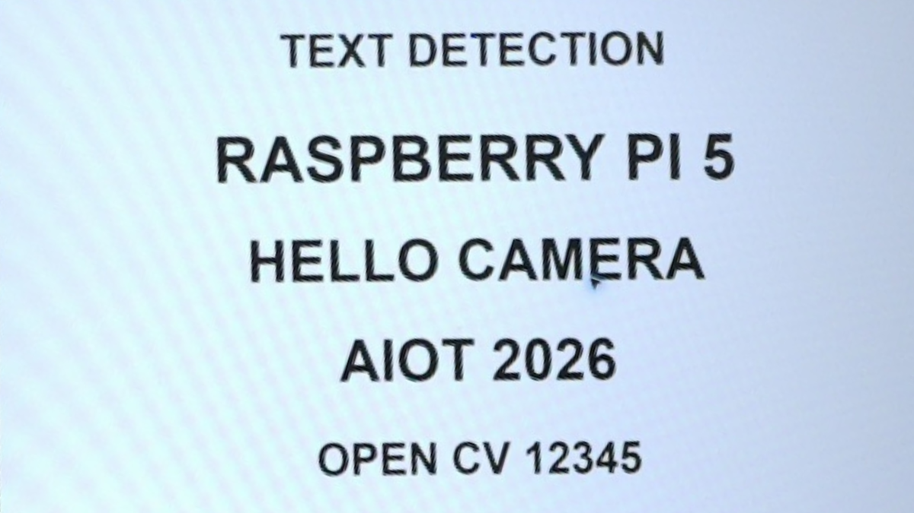
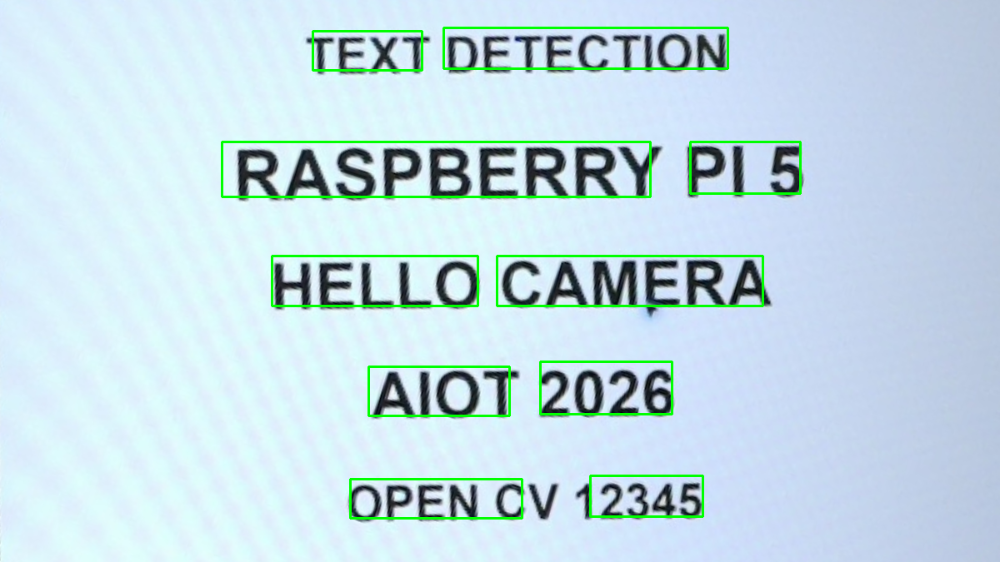

# 55｜相機即時文字偵測：EAST

## [原課號：補充 10｜PiCamera2 + OpenCV + EAST 模型做即時文字偵測](https://github.com/Samuel-ncu/BA5077-RP5-compatibility/blob/main/%E6%95%99%E6%9D%90/%E8%A3%9C%E5%85%85%2010%EF%BD%9CPiCamera2%20%2B%20OpenCV%20%2B%20EAST%20%E6%A8%A1%E5%9E%8B%E5%81%9A%E5%8D%B3%E6%99%82%E6%96%87%E5%AD%97%E5%81%B5%E6%B8%AC.md)

digithouse.net 原文：[補充 10｜PiCamera2 + OpenCV + EAST 模型做即時文字偵測](https://digithouse.net/blog/supplement-10-picamera2-east-realtime-detection?locale=zh-TW)

> **本篇狀態**：用 Picamera2 拍一張影格、交給 EAST 找文字框，在**舊環境**（Bookworm）實測：影格 240 × 320，流程跑完；當時沒有保存相機畫面，也沒有記錄框數。**目前 Trixie** 只重測了[新 54](./54-%E6%89%BE%E5%87%BA%E5%9C%96%E4%B8%AD%E7%9A%84%E6%96%87%E5%AD%97%E6%A1%86%EF%BC%9AEAST.md) 的單張圖片部分（10 個框、空白圖 0 個框），相機這一步尚未在 Trixie 重跑。repo 唯一的「相機連續文字偵測」實測同時用了 Tesseract 讀字，放在[新 56](./56-%E7%9C%8B%E5%BE%97%E5%88%B0%E4%B9%9F%E8%AE%80%E5%BE%97%E5%87%BA%EF%BC%9AEAST%20%E5%8A%A0%20Tesseract.md)。**尚未實測**：只做 EAST 的連續相機預覽、不同距離與角度。

新 54 的 EAST 處理的是存好的照片。這篇把來源換成相機：拍一張、找文字框。我們先從「拍一張」開始，把資料怎麼從相機流到模型看清楚，再說明要變成即時預覽時，需要多處理哪些事。你也會發現，EAST 每張都要花不少時間，所以「即時」在 RP5 上會比你想像的慢。

## 這篇會學到什麼

- 用 Picamera2 拍一張影格，直接交給 EAST。
- 相機影格和照片檔，在程式裡其實是同一種東西。
- 把單張改成連續預覽，需要加哪些部分。
- 為什麼要準備「有字」和「沒字」的對照畫面。

## 需要的東西

- RP5、CSI 相機，以及一個同時能用 Picamera2 和 OpenCV 的環境（例如[新 15](./15-%E7%9B%B8%E6%A9%9F%E7%95%AB%E9%9D%A2%E8%AE%8A%E6%88%90%E6%95%B8%E5%AD%97%EF%BC%9APicamera2%20%E5%8A%A0%20OpenCV%20%E8%AE%80%E4%B8%80%E5%BC%B5%E5%BD%B1%E6%A0%BC.md) 建立的相機環境）。
- 新 54 下載並改名好的 `frozen_east_text_detection.pb`，以及 [east_helpers.py](https://github.com/Samuel-ncu/BA5077-RP5-compatibility/blob/main/%E6%95%99%E6%9D%90/%E7%AF%84%E4%BE%8B%E7%A8%8B%E5%BC%8F/east_helpers.py)。
- [本篇程式](https://github.com/Samuel-ncu/BA5077-RP5-compatibility/blob/main/%E6%95%99%E6%9D%90/%E7%AF%84%E4%BE%8B%E7%A8%8B%E5%BC%8F/%E8%A3%9C%E5%85%8510.py)
- 鏡頭前放清楚的英文印刷字，例如在另一台螢幕顯示 [text-board.png](https://github.com/Samuel-ncu/BA5077-RP5-compatibility/blob/main/%E6%95%99%E6%9D%90/%E5%9C%96%E6%AA%94/text-board.png)。

## 先懂幾個名詞

- **影格**：相機拍到的一張畫面，在 Python 裡是一個 NumPy 陣列，形狀是（高, 寬, 3）。
- **靜態設定（still configuration）**：Picamera2 拍單張照片用的設定。
- **處理速度**：每秒能找完幾張的文字框，和相機每秒能拍幾張是兩回事。

## 一步一步操作

### 步驟 1：讀程式

**為什麼**：重點是「拍完立刻釋放相機，再做推論」。

```python
import cv2
from picamera2 import Picamera2
from east_helpers import detect_text

camera = Picamera2()
try:
    camera.configure(camera.create_still_configuration(main={'size': (320, 240), 'format': 'RGB888'}))
    camera.start()
    frame = camera.capture_array()
finally:
    camera.stop()
    camera.close()
net = cv2.dnn.readNet('frozen_east_text_detection.pb')
boxes = detect_text(net, frame)
print('camera frame', frame.shape)
print('frame processed', True)
```

- `create_still_configuration(main={'size': (320, 240), ...})`：拍一張 320 × 240 的照片。
- 拍到 `frame` 之後，`finally` 立刻停止並關閉相機，其他程式就能用相機。
- 之後的 `detect_text(net, frame)` 和新 54 完全一樣：EAST 不在乎影像來自相機還是檔案。
- 這支程式只印出影格大小，**沒有印出框數，也沒有存圖**，避免把相機拍到的私人畫面存下來。

### 步驟 2：執行

**為什麼**：確認「相機 → 模型 → 文字框」整條路線跑得通。

舊環境的輸出：

```text
camera frame (240, 320, 3)
frame processed True
```

影格是高 240、寬 320、3 個顏色通道，EAST 處理完沒有出錯。這只證明流程能跑，**沒有**驗證框得對不對。想看框數，可以在最後加一行 `print('boxes', len(boxes))`；這個修改本次沒有實測。

### 步驟 3：從單張變成連續預覽

**為什麼**：「即時」就是把步驟 1 放進迴圈。

要改成連續預覽，程式需要多處理這些事：

1. **改用預覽設定**：`create_preview_configuration`，相機持續送出影格。
2. **迴圈**：每次 `capture_array()` → `detect_text` → 用 `cv2.rectangle` 畫框 → `cv2.imshow` 顯示。
3. **停止方式**：按 `q` 結束，或設定時間上限；結束時在 `finally` 釋放相機。
4. **計時**：記錄處理了幾張、花了幾秒，算出每秒張數。

repo 的連續測試把這四件事都做了，而且每個框還交給 Tesseract 讀字，所以放在[新 56](./56-%E7%9C%8B%E5%BE%97%E5%88%B0%E4%B9%9F%E8%AE%80%E5%BE%97%E5%87%BA%EF%BC%9AEAST%20%E5%8A%A0%20Tesseract.md)。那次的速度約每秒 0.58 張，主要時間花在逐框讀字；只做 EAST 找框的連續預覽本次沒有單獨測試。

### 步驟 4：準備對照畫面

**為什麼**：沒找到框，不一定是程式壞了。

如果鏡頭前根本沒有字，0 個框是正確的結果。所以測試時要準備：

- **有字的畫面**：清楚、夠大、水平的英文字。
- **沒字的畫面**：一面空白的牆或桌面。

兩種都測，才分得出「程式有問題」和「畫面裡本來就沒字」。新 54 的全黑、全白圖是程式做出來的負例；相機拍攝的空白背景本次沒有測試。

### 步驟 5：和原文比一比

**為什麼**：原文是完整的即時版本，但寫法有幾處可以改進。

- 原文用 `sudo apt install python3-opencv python3-picamera2` 再 `pip install numpy`；直接對系統 Python 用 pip 在目前 Trixie 會被擋下。本篇使用已建好的相機環境。
- 原文以 640 × 480 連續取像，按 `q` 結束；結束時只有 `stop()`，沒有 `close()` 相機，也沒有 `try ... finally`。
- 原文的解碼函式和新 54 的 `east_helpers.py` 做法相同。

原文的即時版本本次沒有原樣重跑。

## 成果圖



*練習素材：相機拍下螢幕上的英文練習文字，裁切校正後的圖。可以把它顯示在另一台螢幕上，讓 RP5 相機對著拍。*



*程式輸出（舊環境）：新 54 對這張練習板找到的文字框，可以當作相機測試時的對照。*

## 常見問題

| 你看到的情況 | 可能原因 | 先試試看 |
| --- | --- | --- |
| `No module named 'picamera2'` | 選到沒有 Picamera2 的環境 | 改選相機環境（新 15）。 |
| 相機打不開 | 另一支程式還在用相機 | 關掉其他相機程式再試。 |
| `readNet` 找不到模型 | 模型沒改名或不在同一資料夾 | 依新 54 步驟 4 改名成 `frozen_east_text_detection.pb`。 |
| 都找不到字 | 字太小、太遠、反光 | 讓字佔畫面大一點、正對鏡頭、避免反光。 |

以上是常見情況的整理，本次沒有逐一重現。

## 小結

相機影格和照片檔在程式裡是同一種陣列，所以把 EAST 接上相機，只要先拍一張、釋放相機，再交給 `detect_text`。舊環境實測這條路線跑得通；要變成即時預覽，還需要預覽設定、迴圈、停止方式和計時。沒找到字不一定是錯，要準備有字和沒字的畫面對照。

**練習**：在步驟 1 的程式最後加上印出框數和畫框存圖的程式碼，分別對著有字和沒字的畫面各拍 5 次，記錄框數。拍攝時注意不要拍到個人資訊。這是延伸練習，本次尚未實測，請以你實際得到的輸出為準。

## 下一篇預告

找得到字在哪，下一步就是讀出內容。下一篇[56｜看得到也讀得出：EAST 加 Tesseract](./56-%E7%9C%8B%E5%BE%97%E5%88%B0%E4%B9%9F%E8%AE%80%E5%BE%97%E5%87%BA%EF%BC%9AEAST%20%E5%8A%A0%20Tesseract.md)，我們安裝 Tesseract，讀出整張圖和每個框裡的文字，最後接上相機做連續辨識。
