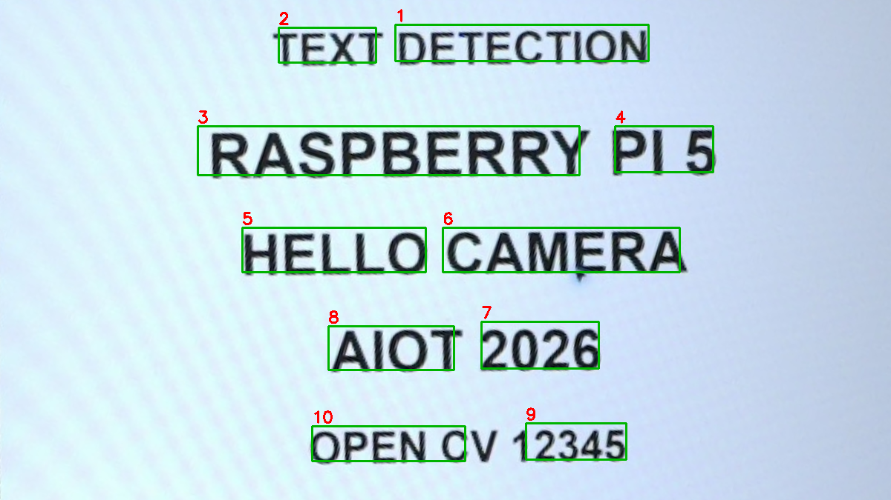
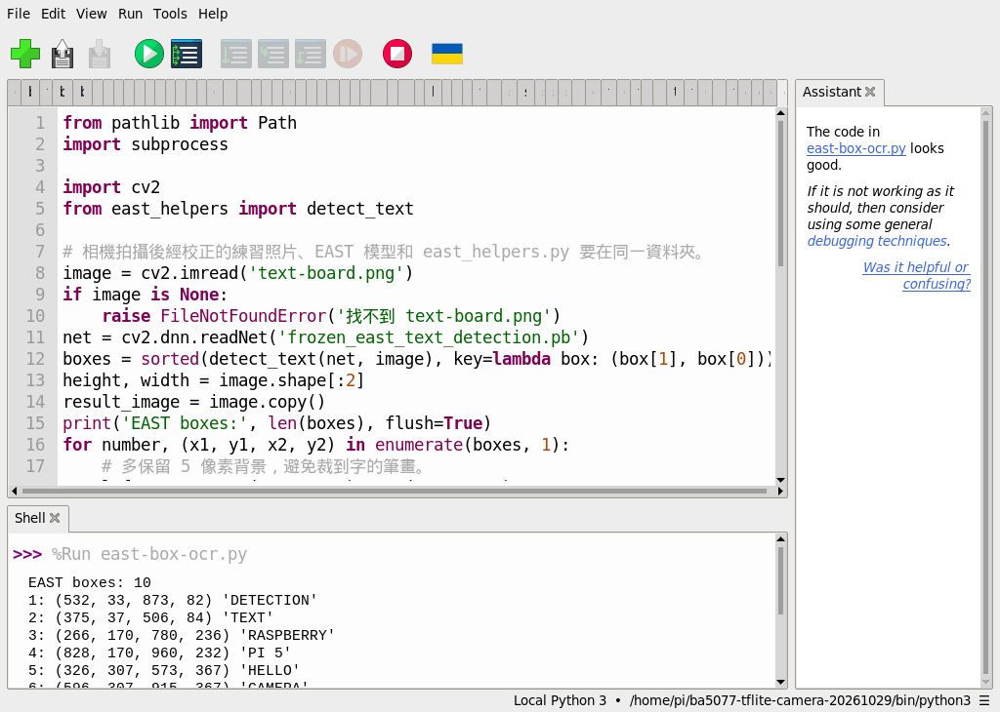
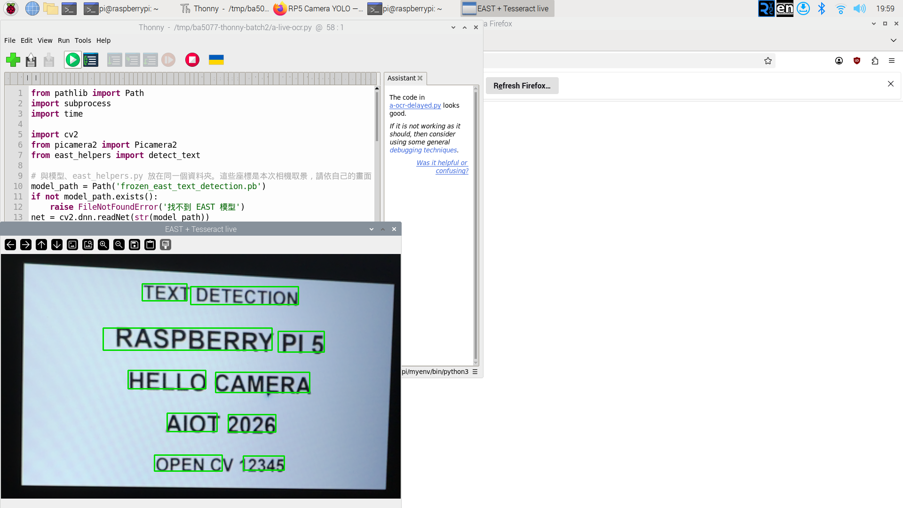
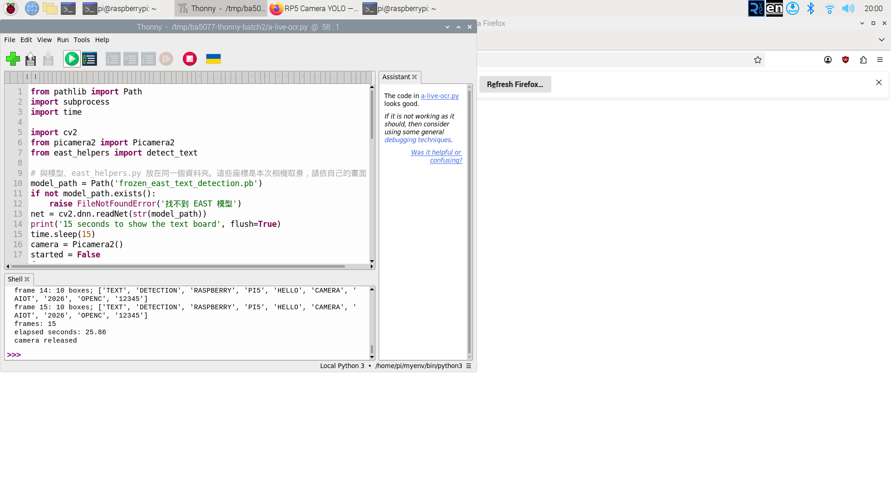
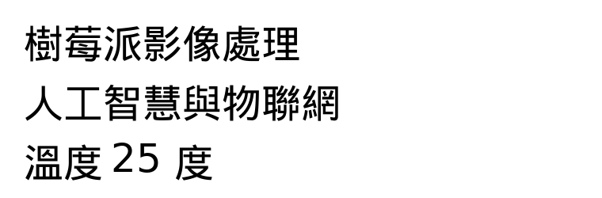
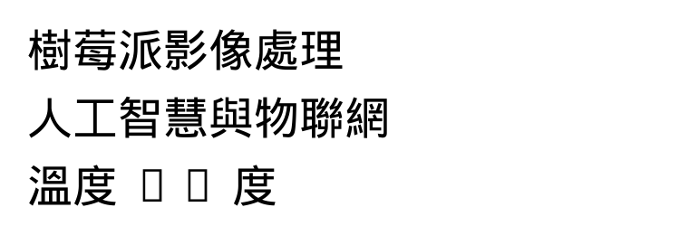

# 56｜看得到也讀得出：EAST 加 Tesseract

## [原課號：補充 11｜🎯 Raspberry Pi 5 上使用 EAST + Tesseract 進行即時文字辨識（含 PiCamera2 即時預覽）](https://github.com/Samuel-ncu/BA5077-RP5-compatibility/blob/main/%E6%95%99%E6%9D%90/%E8%A3%9C%E5%85%85%2011%EF%BD%9C%F0%9F%8E%AF%20Raspberry%20Pi%205%20%E4%B8%8A%E4%BD%BF%E7%94%A8%20EAST%20%2B%20Tesseract%20%E9%80%B2%E8%A1%8C%E5%8D%B3%E6%99%82%E6%96%87%E5%AD%97%E8%BE%A8%E8%AD%98%EF%BC%88%E5%90%AB%20PiCamera2%20%E5%8D%B3%E6%99%82%E9%A0%90%E8%A6%BD%EF%BC%89.md)

digithouse.net 原文：[補充 11｜Raspberry Pi 5 上使用 EAST + Tesseract 進行即時文字辨識（含 PiCamera2 即時預覽）](https://digithouse.net/blog/supplement-11-east-tesseract-realtime-ocr?locale=zh-TW)

> **本篇狀態**：**所有 OCR 結果都來自舊環境**（Bookworm，2026-10-29，Thonny）：整張圖辨識、逐框辨識、相機連續辨識 25 秒、繁體中文合成圖。**目前 Trixie 還沒有安裝 Tesseract**：安裝需要帳號持有人輸入 sudo 密碼，2026-11-12 只確認了套件的候選版本，沒有代為安裝，所以 **OCR 在目前 Trixie 尚未重測**；EAST 找框的部分在目前 Trixie 已重測（見[新 54](./54-%E6%89%BE%E5%87%BA%E5%9C%96%E4%B8%AD%E7%9A%84%E6%96%87%E5%AD%97%E6%A1%86%EF%BC%9AEAST.md)）。**尚未實測**：中文的相機即時辨識、真實街景、長時間運作、全新安裝的系統。

新 54 找到了文字在哪裡，這篇要把字讀出來。負責讀字的是 **Tesseract**，一個開源的 OCR 程式。我們會比較兩種做法：把整張圖丟給 Tesseract，以及先用 EAST 找框、再一框一框交給 Tesseract。最後把相機也接上，做出「看得到也讀得出」的連續辨識，並試試繁體中文。這是本系列的最後一篇。

## 這篇會學到什麼

- 安裝 Tesseract 和語言資料。
- 整張圖辨識和逐框辨識的差別。
- 框切不完整時，OCR 會讀錯。
- 相機連續辨識為什麼很慢。
- 繁體中文 OCR 要注意的事。

## 需要的東西

- 新 54 下載並改名好的 `frozen_east_text_detection.pb`、[east_helpers.py](https://github.com/Samuel-ncu/BA5077-RP5-compatibility/blob/main/%E6%95%99%E6%9D%90/%E7%AF%84%E4%BE%8B%E7%A8%8B%E5%BC%8F/east_helpers.py)、[text-board.png](https://github.com/Samuel-ncu/BA5077-RP5-compatibility/blob/main/%E6%95%99%E6%9D%90/%E5%9C%96%E6%AA%94/text-board.png)。
- 能輸入 sudo 密碼的 RP5 帳號（安裝 Tesseract 用）。
- 程式：
  - [整張圖辨識](https://github.com/Samuel-ncu/BA5077-RP5-compatibility/blob/main/%E6%95%99%E6%9D%90/%E7%AF%84%E4%BE%8B%E7%A8%8B%E5%BC%8F/%E8%A3%9C%E5%85%859%E8%87%B311-%E7%9B%B8%E6%A9%9F%E6%96%87%E5%AD%97.py)
  - [逐框辨識](https://github.com/Samuel-ncu/BA5077-RP5-compatibility/blob/main/%E6%95%99%E6%9D%90/%E7%AF%84%E4%BE%8B%E7%A8%8B%E5%BC%8F/%E8%A3%9C%E5%85%859%E8%87%B311-Thonny%E9%80%90%E6%A1%86%E6%96%87%E5%AD%97%E8%BE%A8%E8%AD%98.py)
  - [相機連續辨識](https://github.com/Samuel-ncu/BA5077-RP5-compatibility/blob/main/%E6%95%99%E6%9D%90/%E7%AF%84%E4%BE%8B%E7%A8%8B%E5%BC%8F/%E8%A3%9C%E5%85%8510%E5%92%8C11-Thonny%E5%8D%B3%E6%99%82OCR.py)
  - [繁體中文 OCR](https://github.com/Samuel-ncu/BA5077-RP5-compatibility/blob/main/%E6%95%99%E6%9D%90/%E7%AF%84%E4%BE%8B%E7%A8%8B%E5%BC%8F/%E8%A3%9C%E5%85%8511-%E7%B9%81%E9%AB%94%E4%B8%AD%E6%96%87OCR.py)

## 先懂幾個名詞

- **Tesseract**：開源的 OCR 程式，是**系統程式**，用 APT 安裝，不是 Python 套件。
- **語言資料**：Tesseract 讀每種語言都需要對應的資料檔，例如英文 `eng`、繁體中文 `chi_tra`。
- **`--psm`**：告訴 Tesseract 版面長什麼樣。`6` 表示一整塊文字，`7` 表示只有一行。

## 一步一步操作

### 步驟 1：安裝 Tesseract

**為什麼**：沒有 Tesseract 就讀不了字。

在 RP5 的**終端機**輸入（會要求輸入自己的密碼）：

```bash
sudo apt update
sudo apt install -y tesseract-ocr tesseract-ocr-eng
tesseract --version
tesseract --list-langs
```

`--list-langs` 應該列出 `eng`。要讀繁體中文，再加裝 `tesseract-ocr-chi-tra`，清單會多出 `chi_tra`。

repo 在 2026-11-12 查過目前 Trixie 的候選版本：`tesseract-ocr` 是 5.5.0-1+b1，`tesseract-ocr-eng`、`tesseract-ocr-chi-tra` 是 1:4.1.0-2。這些指令**本次沒有在目前 Trixie 執行**，你安裝時請以自己看到的訊息為準。

### 步驟 2：整張圖辨識

**為什麼**：最簡單的做法，先看 Tesseract 能讀到什麼。

整張圖辨識程式先用 EAST 畫框存成結果圖，再把**整張** `text-board.png` 交給 Tesseract（`-l eng --psm 6`），不是用 EAST 的框。舊環境的輸出：

```text
EAST boxes: 10
saved: supplement9-camera-east.png
Tesseract output:
TEXT DETECTION
RASPBERRY PI 5
HELLO CAMERA
AIOT 2026
OPEN CV 12345
```

5 行英文全部讀對。練習板很乾淨、字很清楚，這種情況整張圖辨識就很好用。

### 步驟 3：逐框辨識

**為什麼**：遇到雜亂的畫面時，先找框再讀字比較可靠；但框不好時也會讀錯。

```python
from pathlib import Path
import subprocess

import cv2
from east_helpers import detect_text

# 相機拍攝後經校正的練習照片、EAST 模型和 east_helpers.py 要在同一資料夾。
image = cv2.imread('text-board.png')
if image is None:
    raise FileNotFoundError('找不到 text-board.png')
net = cv2.dnn.readNet('frozen_east_text_detection.pb')
boxes = sorted(detect_text(net, image), key=lambda box: (box[1], box[0]))
height, width = image.shape[:2]
result_image = image.copy()
print('EAST boxes:', len(boxes), flush=True)
for number, (x1, y1, x2, y2) in enumerate(boxes, 1):
    # 多保留 5 像素背景，避免裁到字的筆畫。
    left, top = max(0, x1 - 5), max(0, y1 - 5)
    right, bottom = min(width, x2 + 5), min(height, y2 + 5)
    crop = image[top:bottom, left:right]
    ok, png = cv2.imencode('.png', crop)
    if not ok:
        raise RuntimeError('無法編碼裁切影像')
    # -l eng 使用英文資料，--psm 7 將每個區域視為單行文字。
    process = subprocess.run(
        ['tesseract', 'stdin', 'stdout', '-l', 'eng', '--psm', '7'],
        input=png.tobytes(), capture_output=True, check=True,
    )
    text = process.stdout.decode('utf-8').strip().replace('\n', ' ')
    print(f'{number}: ({x1}, {y1}, {x2}, {y2}) {text!r}', flush=True)
    cv2.rectangle(result_image, (x1, y1), (x2, y2), (0, 180, 0), 2)
    cv2.putText(result_image, str(number), (x1, max(20, y1 - 5)),
                cv2.FONT_HERSHEY_SIMPLEX, 0.7, (0, 0, 255), 2)

output = Path('east-box-ocr-result.png')
if output.exists():
    raise FileExistsError('結果圖已存在，請移至其他資料夾後再執行')
if not cv2.imwrite(str(output), result_image):
    raise RuntimeError('無法儲存結果圖')
print('saved:', output)
```

- 框依「上緣 y，再 x」排序。
- 每個框多留 5 像素再裁切，避免切到筆畫。
- `cv2.imencode('.png', crop)` 把裁切影像壓成 PNG，透過 `stdin` 直接交給 Tesseract，不必另存檔案。
- `--psm 7`：每個框當成一行字。

舊環境的輸出：

```text
EAST boxes: 10
1: (532, 33, 873, 82) 'DETECTION'
2: (375, 37, 506, 84) 'TEXT'
3: (266, 170, 780, 236) 'RASPBERRY'
4: (828, 170, 960, 232) 'PI 5'
5: (326, 307, 573, 367) 'HELLO'
6: (596, 307, 915, 367) 'CAMERA'
7: (648, 434, 806, 497) '2026'
8: (442, 440, 611, 499) 'AIOT'
9: (708, 571, 843, 620) '12345'
10: (420, 575, 626, 622) 'OPEN C'
saved: east-box-ocr-result.png
```

兩個值得注意的地方：

- **第 10 框**：原圖是 `OPEN CV`，但 EAST 的框沒有包住 `V`，所以讀成 `OPEN C`。框不完整，OCR 再好也讀不出來。
- **順序**：`DETECTION` 的上緣比 `TEXT` 高一點點，所以排在前面。同一行的框高度略有差異時，排序就不符合閱讀順序；實際應用要先把框依行分組。

### 步驟 4：接上相機連續辨識

**為什麼**：這就是原文標題的「即時文字辨識」。

[相機連續辨識程式](https://github.com/Samuel-ncu/BA5077-RP5-compatibility/blob/main/%E6%95%99%E6%9D%90/%E7%AF%84%E4%BE%8B%E7%A8%8B%E5%BC%8F/%E8%A3%9C%E5%85%8510%E5%92%8C11-Thonny%E5%8D%B3%E6%99%82OCR.py)會先等 15 秒讓你擺好測試板，再以 1280 × 960 連續取像，裁出畫面中放測試板的區域，對每一張做 EAST 找框和逐框 OCR，約 25 秒後自動停止。程式裡的裁切座標 `[0:520, 400:1250]` 是那次的取景，請依自己的畫面調整。

舊環境的測試：相機對著另一台螢幕上顯示的練習板，Shell 最後一筆和結束訊息：

```text
frame 15: 10 boxes; ['TEXT', 'DETECTION', 'RASPBERRY', 'PI5', 'HELLO', 'CAMERA', 'AIOT', '2026', 'OPENC', '12345']
frames: 15
elapsed seconds: 25.86
camera released
```

- 25.86 秒只處理了 15 張，約每秒 0.58 張。慢的原因是每一框都要呼叫一次 Tesseract，一張就要呼叫 10 次。
- `PI5` 少了空格，`OPENC` 又少了 `V`：相機重拍一次螢幕，畫質變差，加上框切不完整，誤差就出現了。
- 這支程式的 `q` 停止分支沒有單獨測試過。

### 步驟 5：試試繁體中文

**為什麼**：中文 OCR 有它自己的坑。

[繁體中文 OCR 程式](https://github.com/Samuel-ncu/BA5077-RP5-compatibility/blob/main/%E6%95%99%E6%9D%90/%E7%AF%84%E4%BE%8B%E7%A8%8B%E5%BC%8F/%E8%A3%9C%E5%85%8511-%E7%B9%81%E9%AB%94%E4%B8%AD%E6%96%87OCR.py)用 Pillow 和系統字型畫出三行中文（含數字 25），再交給 Tesseract，比較只用 `chi_tra` 和 `chi_tra+eng` 的結果。這個練習**沒有用 EAST**，只測 OCR。它需要練習資料夾裡有 `tessdata`，放入從 [Tesseract 官方 tessdata_fast](https://github.com/tesseract-ocr/tessdata_fast) 取得的 `chi_tra.traineddata` 和 `eng.traineddata`。舊環境的輸出：

```text
saved: supplement11-chinese-input.png
OCR output (chi_tra):
樹莓派影像處理
人工智慧與物聯網
溫度25 度
OCR output (chi_tra+eng):
樹莓派影像處理
人工智慧與物聯網
溫度25 度
```

兩種設定結果相同，中文都讀對，只有數字前後的空格和原圖不同。repo 還記錄了一個坑：第一次只用中文字型畫圖，那個字型**沒有數字的字形**，「25」被畫成方框，OCR 當然讀不出來；換成有數字的字型才成功。所以讀錯時，先看輸入圖本身對不對。

### 步驟 6：和原文比一比

**為什麼**：原文的安裝步驟多了不需要的東西，也少了中文需要的東西。

- 原文安裝了 `libtesseract-dev`（給 C/C++ 開發用的檔案），只用 Tesseract 讀字時不需要；本篇只裝執行程式和語言資料。
- 原文用 `pip install pytesseract numpy`，直接對系統 Python 用 pip 在目前 Trixie 會被擋下。本篇的程式改用 `subprocess` 直接呼叫 `tesseract`，不需要 `pytesseract`。
- 原文的延伸建議寫 `lang="chi_tra+eng"`，但沒有安裝繁體中文語言資料；沒有 `chi_tra` 時 Tesseract 會出錯。
- 原文以 640 × 480 即時處理，按 `q` 結束，結束時沒有 `close()` 相機。

原文的程式本次沒有原樣重跑。

## 成果圖



*程式輸出（舊環境）：步驟 3 的逐框辨識，綠框加紅色編號。注意第 10 框沒有包住 `V`。*



*操作截圖（舊環境）：步驟 3 的 Shell 輸出。*



*操作截圖（舊環境）：步驟 4 的相機連續辨識，視窗內是相機實拍並由程式畫框的畫面。*



*操作截圖（舊環境）：步驟 4 結束，15 張、25.86 秒，相機已釋放。*



*程式輸出（舊環境）：步驟 5 的繁體中文合成輸入圖。*



*程式輸出（舊環境）：只用中文字型時，數字「25」變成方框。*

## 常見問題

| 你看到的情況 | 可能原因 | 先試試看 |
| --- | --- | --- |
| `FileNotFoundError: 'tesseract'` | 還沒安裝 Tesseract | 依步驟 1 用 APT 安裝。 |
| `Failed loading language 'chi_tra'` | 沒有繁體中文語言資料 | 安裝 `tesseract-ocr-chi-tra`，或在 `tessdata` 放入 `chi_tra.traineddata`。 |
| 讀出來少了字母 | EAST 的框沒包住整個字 | 對照結果圖檢查框；可以把裁切邊界留大一點。 |
| 中文數字變成方框 | 畫圖用的字型沒有那個字 | 換一個有該字形的字型。 |
| 相機辨識非常慢 | 每框都呼叫一次 Tesseract | 這是正常的；減少框數或只處理部分畫面。 |

以上整理自 repo 的實測紀錄與排錯說明，本次沒有逐一重現。

## 小結

文字辨識分兩步：EAST 找出字在哪，Tesseract 讀出字是什麼。乾淨的圖整張丟給 Tesseract 就能讀對；逐框辨識的品質取決於框完不完整，`OPEN CV` 就因為框少了 `V` 被讀成 `OPEN C`。接上相機後每框都要呼叫 Tesseract，每秒只有約 0.58 張。本篇的 OCR 結果都來自舊環境；目前 Trixie 還沒裝 Tesseract，需要你自己輸入密碼安裝後重測。

**練習**：

1. 把逐框辨識的裁切邊界從 5 像素改成 15 像素，先預測第 10 框能不能讀出 `OPEN CV`，再執行驗證。
2. 寫一個小函式，把 y 座標相差不到 20 像素的框歸成同一行，再依 x 排序，讓輸出符合閱讀順序。

這些是延伸練習，本次尚未實測，請以你實際得到的輸出為準。

## 系列結語

從新 00 的導讀、架設 Raspberry Pi，到相機、OpenCV、YOLO、語言模型、MediaPipe，最後到文字辨識，本系列共 57 篇，每一篇都標明哪些在目前的系統實測過、哪些還沒有。還沒測的部分，正好是你可以接著動手的地方。回到[新 00｜導讀](./00-%E5%B0%8E%E8%AE%80%EF%BC%9A%E5%BE%9E%20Bookworm%20%E5%88%B0%20Trixie%EF%BC%8C%E9%80%99%E5%A5%97%E6%95%99%E6%9D%90%E6%94%B9%E4%BA%86%E4%BB%80%E9%BA%BC.md)，可以看到整個系列的地圖。
